# The Report Line: System Design

| | |
|---|---|
| **System** | Discord slash-command bot with an admin dashboard |
| **Status** | Implemented (build steps 1 to 6). Public deployment pending, see Appendix A |
| **Version** | 2.0, 2026-10-12 |
| **Author** | Rohan Urankar |
| **How it was produced** | Design led by Rohan with Claude as a design assistant. Code written by Claude coding agents working from this document, reviewed and committed by Rohan (§17) |
| **Stack** | Node.js 22 + TypeScript + Express 5, Angular 21 + Angular Material 3, PostgreSQL 16+ |

---

## 0. How to read this

**The system in one paragraph.** Discord sends every slash command, button click and form submit to one HTTPS endpoint as a signed POST. The app verifies the Ed25519 signature, writes the interaction, what it decided to do, and (for slow work) a job into PostgreSQL in a single transaction keyed on Discord's interaction id, then answers Discord inside its 3-second window. A background worker in the same Node process claims jobs from that table, optionally tags the report with Gemini, mirrors it to a Slack channel, and edits the original Discord reply with the result. If the reply can no longer be edited, it posts to a channel with the bot token instead. An Angular dashboard, served from the same origin, lets an admin sign in, connect a server, watch every command with its retry history, and change how each command behaves.

**Section map.** Section numbers are stable: source comments reference them as `DESIGN §n`.

| § | Contents | § | Contents |
|---|---|---|---|
| 1 | Requirements, quality priorities, traceability | 10 | Sequence diagrams |
| 2 | Architecture overview and the end-to-end flow | 11 | State machines and the worker's steps |
| 3 | Discord credentials | 12 | Design patterns used |
| 4 | Discord mechanics, verified against the docs | 13 | Threat model (STRIDE) |
| 5 | Commands and interaction contracts | 14 | Failure handling and observability |
| 6 | Dashboard (frontend) design | 15 | Architecture Decision Records |
| 7 | Module structure and runtime model | 16 | Build plan and verification |
| 8 | Interfaces and class view | 17 | Agent-assisted development: the scaffolding |
| 9 | Data model and database schema | A–E | Deployment, adverse scenarios, limitations, references, changelog |

**Suggested walkthrough when presenting:** §2.5 (the whole flow in one picture) → §2.2 (what runs where) → §9.1 (schema) → §10.2 (a `/report` from start to finish) → §11.3 (how the worker avoids doing anything twice) → §12 (patterns) → §13 (security) → §17 (how the agents built it).

**Identifiers.** F-xx functional requirement, NFR-xx quality requirement, T-xx threat, SR-x security requirement, ADR-xxxx decision record, [Dn] a Discord documentation reference in Appendix D.

---

## 1. Requirements

### 1.1 Functional

| ID | Use case | Actor | Scope | Status |
|---|---|---|---|---|
| F-01 | Admin signs in to the web app | Admin | Core | Built |
| F-02 | Admin connects a Discord server (bot added, post channel chosen) | Admin | Core | Built |
| F-03 | User runs a slash command; the system records it | Server member | Core | Built |
| F-04 | The system applies a rule and responds in Discord | System | Core | Built |
| F-05 | The system mirrors a notification to a second channel (Slack) | System | Core | Built |
| F-06 | Dashboard (behind login) shows a live log of commands and actions | Admin | Core | Built (polling, ADR-0006) |
| F-07 | Admin configures command behaviour in the UI | Admin | Core and stretch | Built |
| F-08 | `/report` opens a modal to collect text | Server member | Stretch | Built |
| F-09 | Buttons on the reply trigger a follow-up action | Server member | Stretch | Built |
| F-10 | Per-attempt retry and failure history is visible | Admin | Stretch | Built |
| F-11 | Each connected server is isolated with its own config | Admin | Stretch | Built |
| F-12 | An LLM tags the report text | System | Stretch | Built, behind `LLM_ENABLED` |
| F-13 | Live dashboard updates via server-sent events | Admin | Stretch | Not built: polling instead (ADR-0006) |

Two commands ship. **`/status`** is the fast path: it reads a few counts and replies inline. **`/report`** is the slow path: modal or text option, deferred reply, background work, edited reply. Between them they use every interaction type the brief names (1 PING, 2 command, 3 component, 5 modal submit) and every response style (inline, modal, defer, update).

### 1.2 Quality requirements

| ID | Attribute | Measurable target | Brief's quality bar |
|---|---|---|---|
| NFR-01 | Request authenticity | Every inbound request Ed25519-verified; forged, malformed or replayed requests get 401 before any parsing or side effect | "Not foolable by forged or replayed requests" |
| NFR-02 | Exactly-once effect | One interaction id produces at most one action, even under concurrent duplicate delivery | "Not do the same thing twice … dedup on the interaction id" |
| NFR-03 | Durability | No interaction lost if Slack, Gemini or our own process is briefly unavailable | "Not silently lose an interaction" |
| NFR-04 | Responsiveness | Initial response within 3 s; slow work finishes inside the 15-minute token window or falls back | "Respect Discord's ~3-second response window" |
| NFR-05 | Tenant isolation | An admin can only read or write servers they manage; tampered ids return 404 | Multi-server stretch goal |
| NFR-06 | Secret hygiene | Bot token, webhook URLs, interaction tokens, API keys never in the repo, client bundle or logs | "Must never expose secrets" |
| NFR-07 | Observability | Every interaction traceable by its id; retries and failures visible on the dashboard | "Structured logs, a visible history of failures and retries" |

### 1.3 Quality attribute priority

**Security ≈ Reliability > Responsiveness > Code clarity > Cost and scale.**

The brief asks for something that "will run unattended" and lists forged requests, duplicates, downstream outages and slow work as the bar, so security and reliability share the top. The 3-second window is a hard constraint but has a known mechanism (defer, then work in the background), so it ranks below them. Cost is fixed at zero (free tiers only) and load is tiny (§1.4), so scale is deliberately last. Every trade-off in this document is resolved against this order.

### 1.4 Capacity estimate

Expected use: a handful of servers, bursts of 10 to 30 interactions, sustained well under 1 request per second. Each command writes one `interaction` row, one `action` row, at most one `job` row and 1 to 5 `job_attempt` rows. Ten thousand commands is about 50,000 rows in total, far inside a free Postgres tier. One worker claiming 5 jobs per tick drains a 30-job burst in a few seconds.

Consequence: **no Redis, no message broker, no cache, no read replica, no sharding.** Postgres is the only datastore. Anything on that list would need a requirement to pay for it, and none exists.

### 1.5 Requirement traceability

| Brief requirement | Mechanism | Where |
|---|---|---|
| Public interactions endpoint, PING answered | `POST /interactions`, PONG after verification | §4, §10.1 |
| At least two slash commands registered | `/status`, `/report`, guild bulk-overwrite via `npm run register-commands` | §5, [D3] |
| Commands recorded | Interaction + action rows in one transaction | §9, §10.2 |
| Bot writes back in Discord | Inline reply, deferred reply edited with `PATCH @original`, channel fallback | §5.4, §11.3 |
| Mirror to a second channel | Slack Incoming Webhook, per server, stored encrypted | §9.6, §11.3 |
| Dashboard behind login: log, actions, config | Angular SPA, session cookie, tenant-scoped API | §6, §10.4 |
| Signature verified on every request | `verifySignature` + `isTimestampFresh`, 401 on failure | §4, §13 |
| Dedupe on interaction id | Primary key + `INSERT … ON CONFLICT DO NOTHING` | §9.3, §10.3 |
| No silent loss when downstream is down | Transactional outbox, retries with backoff, lease recovery | §11, §14 |
| 3-second window respected | Defer (type 5), all slow work in the worker, request-path DB timeouts | §5, §7.1 |
| No secrets exposed | Env-only secrets, AES-GCM at rest, pino redaction, hooks that block secrets in code | §9.6, §13, §17 |
| Stretch: rules in the UI, buttons, modal, AI, multi-server, observability | §5.5, §5.3, §5.2, §11.3, §9 + §10.4, §14 | |

---

## 2. Architecture overview

**Style: a modular monolith.** One TypeScript codebase, one deployable, two roles inside it: the HTTP API and a background worker. The core logic (verify, route, evaluate rules, classify failures, build replies) is pure and does no I/O. Postgres, Discord, Slack and Gemini sit behind interfaces (**ports and adapters**, also called hexagonal architecture), so the reliability-critical code is unit-tested without a network.

Alternatives considered and rejected:

- **Microservices** (separate endpoint, worker and dashboard services). Nothing needs independent scaling, deploy cadence or a technology boundary. More moving parts, no requirement paying for them.
- **Serverless functions only.** The retrying worker would need an external queue or cron, and cold starts put the 3-second window at risk.
- **Postgres plus Redis/BullMQ.** A second datastore and failure mode for under one message per second, and writing to two stores loses atomicity unless an outbox is added anyway (ADR-0001).

The two roles:

- **API.** Hosts the Discord interactions endpoint (the only route that reads the raw body), the dashboard JSON API under `/api`, sign-in, `/healthz`, and the built Angular app. It must answer Discord within 3 seconds and never waits on slow work.
- **Worker.** Drains the job table. Claims jobs with `FOR UPDATE SKIP LOCKED`, calls Gemini and Slack, records each attempt, retries with backoff and jitter, and closes the loop in Discord. It runs as a loop inside the API process by default, or alone with `WORKER_MODE=standalone` (ADR-0002).

### 2.1 System context

*Who and what the system talks to.*

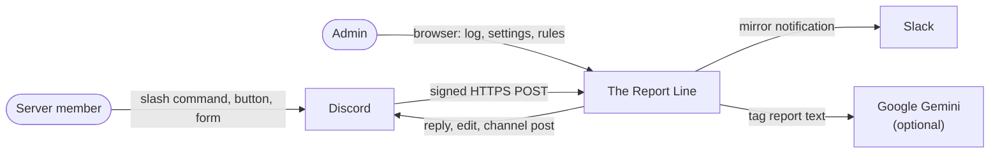

### 2.2 Containers

*What runs, and how the parts talk to each other.*

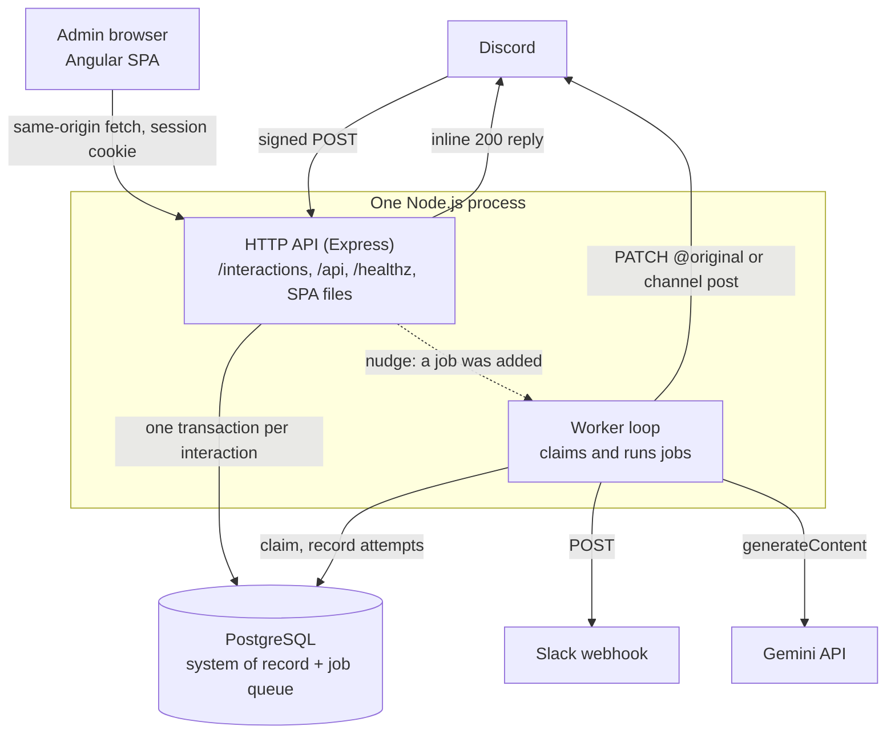

| Container | Responsibility | Technology | Data |
|---|---|---|---|
| Angular SPA | Sign-in, server list, command log, settings, rules | Angular 21, Material 3, signals | None stored; calls `/api` |
| HTTP API | Verify and route interactions, dashboard API, auth, serve the SPA | Express 5, TypeScript | Writes interactions, actions, jobs, config |
| Worker | Tag, mirror, reply, fallback, retry | Same codebase, async loop | Updates jobs, attempts, actions |
| PostgreSQL | System of record, deduplication, job queue | PostgreSQL 16+ | Everything (§9) |

### 2.3 Layers inside the API process

*Which code may depend on which. Arrows point at what is depended on.*

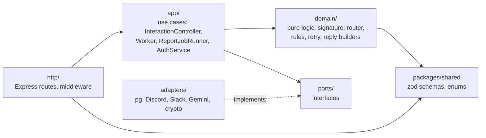

`domain/` imports only `domain/`, `@report-line/shared`, `zod`, and `node:crypto` (in `signature.ts` only). `app/` imports `domain/`, `ports/` and shared. Neither imports Express, `pg` or `fetch`. ESLint enforces this as an allow-list per folder, so a wrong import fails the build rather than a code review.

### 2.4 Data flow and trust boundaries

*Where untrusted data enters and where secrets travel. Flow numbers are used by the threat model (§13).*

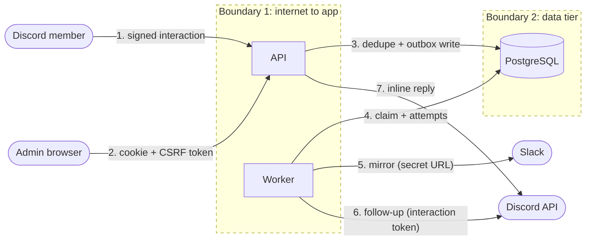

### 2.5 The whole flow in one picture

*Everything that happens to one `/report`, from Discord's POST to the edited reply.*

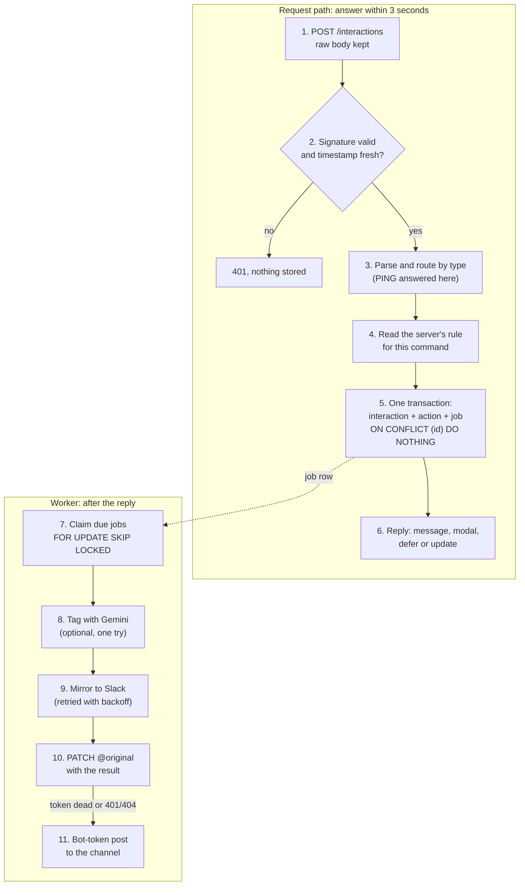

How to talk through it: steps 1 to 6 are synchronous and bounded by timeouts that add up to less than 3 seconds (§7.1). Step 5 is where exactly-once and durability are won: the job exists before Discord hears back. Steps 7 to 11 can fail and retry freely, because each step leaves a marker in the database and skips itself next time (§11.3).

---

## 3. Discord credentials

| Credential | Direction | Used for | Secret? | Where it lives |
|---|---|---|---|---|
| Application ID | names the app | Command registration, follow-up URLs | No | Env |
| **Public key** | Discord → us | Verifying every inbound signature | No (it only verifies) | Env |
| **Bot token** | us → Discord | Channel fallback post, command registration | **Yes** | Env only |
| **Interaction token** | Discord → us, per interaction | Editing that one reply for 15 minutes | **Yes, a short-lived capability** | Its own `job` column, never logged |
| Client secret | us → Discord OAuth2 | "Sign in with Discord" | Yes | Not used in v1 |

The distinction that matters: the **public key** can only verify, so leaking it lets nobody forge anything. The **bot token** acts as the bot anywhere it has permissions, so it is a real secret. The **interaction token** is a 15-minute capability for one reply; it needs no bot token, which is why it must never appear in a log line or a stored JSON blob [D1].

---

## 4. Discord mechanics, verified against the documentation

Every rule below was checked against Discord's developer documentation (references in Appendix D, last checked 2026-10-12).

**Signature verification.** Each request carries `X-Signature-Ed25519` (hex) and `X-Signature-Timestamp`. The app must verify the Ed25519 signature over the bytes `timestamp + rawBody` with the application public key, on every request, and answer 401 if it fails. Discord runs automated checks that deliberately send invalid signatures; an endpoint that accepts them is removed and the owner is notified [D2]. Rejecting forgeries is therefore a liveness requirement, not only hygiene.

Implementation notes:
- Verify over the **raw bytes**. Re-serialised JSON changes the bytes and every signature fails. Express mounts `express.raw()` on `/interactions` only, and `express.json()` on `/api` only.
- Malformed input returns `false`, never throws. Hex is checked with a regex for exact length (128 hex characters for the signature, 64 for the key) because `Buffer.from('zz', 'hex')` silently truncates rather than failing.
- `node:crypto` Ed25519 is used instead of the `discord-interactions` package, because its `verifyKey` is asynchronous and the contract here is a synchronous boolean (ADR-0007).

**Ed25519 versus HMAC.** Discord signs with a private key it never shares; we hold only the public key, which cannot sign. With HMAC (Slack, GitHub, Stripe) one shared secret both signs and verifies, so a leak lets an attacker forge, and comparisons must be constant-time. Ed25519 verification has only public inputs, so there is no secret to leak through timing.

**The two clocks.** The initial response must arrive within **3 seconds**. The interaction token is valid for **15 minutes** for edits and follow-ups [D1].

**PING.** When the endpoint URL is saved, Discord sends `type: 1`. The app answers `200` with `{"type": 1}` [D2].

**Interaction types (inbound).** 1 PING, 2 APPLICATION_COMMAND, 3 MESSAGE_COMPONENT, 4 AUTOCOMPLETE, 5 MODAL_SUBMIT. This app handles 1, 2, 3 and 5 [D1].

**Response types (outbound).** 1 PONG, 4 CHANNEL_MESSAGE_WITH_SOURCE, 5 DEFERRED_CHANNEL_MESSAGE_WITH_SOURCE, 6 DEFERRED_UPDATE_MESSAGE, 7 UPDATE_MESSAGE, 9 MODAL. Types 6 and 7 are valid only for component and modal-submit interactions; type 9 is not valid for PING or MODAL_SUBMIT [D1].

**Modals.** A modal must be the *immediate* response to a command or a button. There is one initial-response slot, and follow-ups can only create or edit messages, so a modal cannot come after a defer. For `/report` this means the decision "form or text?" is made on the first request, and the form's submit arrives as a new interaction with its own id, token and 3 seconds.

**Replying.** The initial response is returned inline as the HTTP 200 body. After a defer, the reply is filled with `PATCH /webhooks/{application_id}/{interaction_token}/messages/@original`. Discord documents that a POST follow-up straight after a defer edits the original only for backwards compatibility, and that this behaviour is deprecated [D1]. PATCH is also the right choice for retries: repeating a PATCH writes the same message again, while repeating a POST would create a second message.

**Ephemeral flag.** `1 << 6` = 64. On a deferred reply it is the only flag allowed, so visibility is decided at defer time and cannot change later.

**After 15 minutes** the token is dead and every follow-up call fails. The only route left is a normal channel message with the bot token (needs View Channel and Send Messages), which cannot be ephemeral.

**Rate limits.** On 429, wait for `Retry-After` / `retry_after`. Discord temporarily bans an IP that sends too many invalid requests: currently 10,000 responses of 401, 403 or 429 in 10 minutes [D5]. This is why a deterministic 401 is never retried (§11.4).

**Command registration.** Guild commands, `PUT /applications/{app_id}/guilds/{guild_id}/commands`, update immediately; global commands are available everywhere but are not instant. Both PUT endpoints replace the whole set. Limit: 200 command creates per day per guild. Chat-input names are lowercase, 1 to 32 characters [D3].

**Install scopes.** OAuth2 scope `bot` with permissions 3072 (View Channel 1024 + Send Messages 2048) [D6]. The bot needs nothing more: replies use interaction tokens, and only the fallback posts as the bot.

**Components** [D4]: Action Row 1, Button 2, Text Input 4, Label 18. Button styles Primary 1, Secondary 2, Success 3, Danger 4. `custom_id` is 1 to 100 characters and unique within a message. A modal has `custom_id`, `title` (max 45) and 1 to 5 components. On submit, fields arrive either in the Label layout (`type 18 → component type 4`) or the older Action Row layout (`type 1 → components[type 4]`); the router accepts both.

---

## 5. Commands and interaction contracts

### 5.1 `/status` (fast path, type 4)

No options. Reads indexed counts for the current server ("N reports today, M retrying, worker last active S seconds ago") and replies inline with type 4. The read is bounded by `STATUS_TIMEOUT_MS`; if it is too slow the user gets "status unavailable" instead of a timeout.

### 5.2 `/report` (slow path: modal, defer, background work, edit)

Registered with an optional string option `text` (1 to 1000 characters).

- **With `text`:** respond type 5 (defer) at once, after writing interaction, action and job in one transaction. The worker does the rest and edits the reply.
- **Without `text`:** respond type 9 (modal) at once; nothing is stored. The submit is a new MODAL_SUBMIT interaction: verified, the rule is evaluated again, then the same defer-and-enqueue path as above.

### 5.3 Buttons: Acknowledge and Escalate (types 3 and 7)

The edited `/report` reply carries one action row with **Acknowledge** (Success style) and **Escalate** (Primary style). A click is a new MESSAGE_COMPONENT interaction: verified, deduplicated on its own id, authorised on the server side, recorded, and answered with type 7 (update the message in place). No job is needed because the action is database-only.

### 5.4 Response decision table

| Inbound | Response | What the user sees |
|---|---|---|
| PING (1) | PONG (1) | nothing |
| `/status` (2) | type 4 message | immediate reply |
| `/report` (2) with text | type 5 defer → worker → `PATCH @original` | "thinking…", then the result |
| `/report` (2) without text | type 9 modal | a form |
| Modal submit (5) | type 5 defer → worker → `PATCH @original` | "thinking…", then the result |
| Button (3) | type 7 update message | the message changes in place |
| Disabled or unknown command | type 4 ephemeral notice | a short private message |
| DM (no server) | type 4 ephemeral notice | "only works in servers" |
| Database unreachable | type 4 ephemeral "not logged" | a private notice within 3 s, never a 500 |

If the worker finishes after the token has expired, or the edit is refused with 401/404, the reply becomes a channel post with the bot token (§11.3). A duplicate delivery of any row is absorbed by the primary key (§10.3).

### 5.5 Detailed behaviour

**Modal path.**
- Opening the form records nothing: no effect has happened yet.
- A present but blank `text` option is an error notice, not a modal: the user chose the text path.
- On submit, `custom_id` must equal `report_modal` and the `report_text` field must be 1 to 1000 code points after trimming. Anything else gets an ephemeral notice and **no row, no job**.
- The rule is evaluated again at submit, because that is where the defer and the job happen. Disabled means the disabled notice.
- The stored row has `type = 5`, `command_name = 'report'`, `custom_id = 'report_modal'`, `options = NULL`. The report text lives only in `job.payload`.

**Buttons.**
- `custom_id` is `rpt:ack:{reportId}` or `rpt:esc:{reportId}`, built and parsed only in `domain/reportButtons.ts`. The report id is a snowflake, so the id never carries the token or the report text.
- **Authorisation is server-side.** The server id comes from the signed payload; the `custom_id` supplies only a report id. The report must exist in that server and be a report. Anything else gets one ephemeral answer, "I can't find that report on this server", so the response never confirms another server's data.
- **Report state** is derived from action rows, not stored:

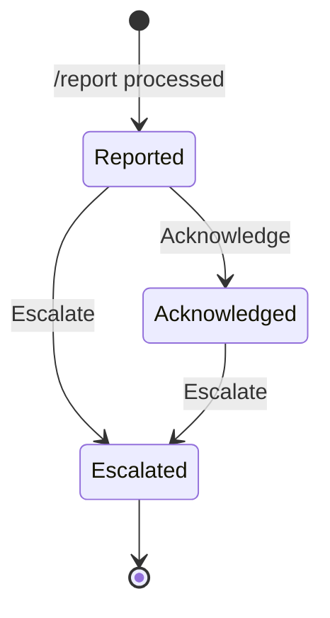

- **The database enforces the state machine.** One transaction locks the report's action row (`SELECT … FOR UPDATE`, so clicks on one report take turns), inserts the click's interaction `ON CONFLICT DO NOTHING`, then inserts the click's action only if no blocking row exists. A unique index on `(report_id, type)` is the backstop. A refused click rolls back and leaves no trace; the user sees "already acknowledged by …".
- **Who may click:** any member of the server who can see the message. With the default ephemeral reply that is only the reporter. If an admin makes `/report` public, any member can act on any visible report. A role or `MANAGE_GUILD` check from `member.permissions` is the next step; not built.
- The channel fallback carries **no buttons**: it is public, and a private report must not become actionable by the whole channel.
- Escalate records and displays the state only. It calls no external service.
- The type 7 body is rebuilt from the database on every click and sent through one builder that cuts at 2000 characters and sets `allowed_mentions: {parse: []}`, so mentions render but ping nobody.

**Rules at runtime.**
- `app/ruleResolution.ts: resolveAction` is the single place a stored rule becomes an `Action`. It reads `command_rule` for the signed server id with a 400 ms deadline, validates it with `validateRule`, and calls `evaluate`, which falls back to `DEFAULT_RULES` if the row is invalid. An invalid row is logged as `rule.invalid_stored` with field names only.
- If the rule cannot be read at all, the user gets "not logged" rather than a guess.
- **Snapshot at enqueue.** `ephemeral`, `replyMessage`, `mirror` and `tag` are copied into `job.payload` when the job is written, so an admin editing the rule mid-flight cannot change what an in-progress report shows or reveals.
- **Disabled means off on every path:** `/status`, `/report` text, `/report` form, the submit and both buttons.

---

## 6. Dashboard (frontend) design

**Stack.** Angular 21 with standalone components, signals and zoneless change detection; Angular Material 3. Built by `npm run build` and served by Express from the same origin as the API (ADR-0003 explains why this is required).

**Structure.**

```
apps/web/src/app
  core/       app-wide services: api client, auth store and guards, HTTP interceptors,
              guild store, polling loop, layout shell, error mapping, a11y helpers
  features/   one folder per screen: auth (login), servers (landing, connect),
              command-log (table, detail), settings, rules
  shared/     presentational UI (status badge, error panel, empty state) and formatters
```

**Routes** (every feature is lazy-loaded):

| Path | Screen | Guard |
|---|---|---|
| `/login` | Sign in | guest only |
| `/` | Your servers (redirects to the first server) | signed in |
| `/connect` | Connect a server by id | signed in |
| `/g/:guildId/log` | Command log, live | signed in |
| `/g/:guildId/log/:interactionId` | One command with its attempt timeline | signed in |
| `/g/:guildId/settings` | Post channel, Slack webhook (write-only) | signed in, unsaved-changes guard |
| `/g/:guildId/rules` | Per-command rules editor | signed in, unsaved-changes guard |

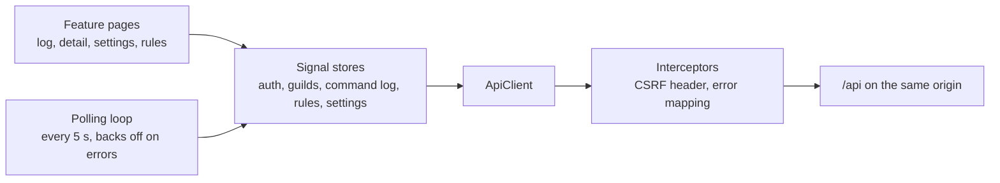

**Design choices.**
- **State in signal stores.** Each store owns one slice (for example the command log) and exposes read-only signals; components react to the store rather than to their own awaited calls. That rule exists because of a real defect (§17.7, journal entry 29).
- **Live log by polling.** The first page is re-fetched every 5 seconds and merged by id, so retrying rows change status in place and new rows appear on top. On errors the loop backs off and honours `Retry-After` (ADR-0006).
- **Security in the browser.** No secrets in the bundle. The session is an `HttpOnly` cookie the JavaScript cannot read; the CSRF token comes from `/api/auth/me` and is added to every mutation by an interceptor. The Slack webhook is a write-only field: the API returns only `mirrorConfigured: true/false`.
- **No business rules in the UI.** The rules editor binds to the zod schemas in `packages/shared`; the server validates again and returns field paths, never values.
- **Accessibility.** Every screen has loading, empty, error and loaded states; focus moves to the page heading on navigation; page titles are set per route; an automated a11y spec covers the main screens.

---

## 7. Module structure and runtime model

```
apps/api/src
  index.ts        entry point: HTTP server + in-process worker, or the worker alone (WORKER_MODE)
  compose.ts      composition root: builds worker, auth, dashboard and config services by hand
  config.ts       the only reader of process.env; zod-validated, refuses to start if invalid
  domain/         pure logic, no I/O (the heavily unit-tested code)
    signature.ts        verifySignature, isTimestampFresh
    router.ts           parseInteraction, classify → RouteDecision
    rules.ts            validateRule, evaluate → Action
    retry.ts            classifyFailure, nextBackoffMs, retryDelayMs
    discordResponses.ts pong / message / defer / update builders; plainBody (2000-char cut, no pings)
    reportModal.ts, reportButtons.ts, reportReplies.ts, reportState.ts, reportJob.ts
    tagging.ts, mirrorMessage.ts, status.ts, messages.ts, failureReasons.ts
    fieldPaths.ts, logCursor.ts, windowRateLimiter.ts, webhookUrl.ts, types.ts
  app/            use cases, depend on domain + ports only
    interactions.ts     InteractionController: verify → route → rule → record → reply
    ruleResolution.ts   resolveAction (the one runtime rule read)
    worker.ts           Worker: claim loop, heartbeat, nudge, failure backoff
    reportJobRunner.ts  ReportJobRunner: tag → mirror → follow-up → fallback
    auth.ts, dashboard.ts, guildConfig.ts, health.ts, deadline.ts
  ports/          interfaces: ledger, jobs, discord, slack, tagger, rules, reportActions,
                  auth, dashboard, guildConfig, health, heartbeat, clock, random, logger, webhookCipher
  adapters/       implementations
    httpCall.ts         the one fetch wrapper: timeout, no redirects, bounded body, CallResult
    discordHttp.ts, discordCommands.ts, slackHttp.ts, geminiHttp.ts
    aesGcmWebhookCipher.ts, argon2PasswordHasher.ts, nodeSessionCrypto.ts, systemClock.ts
    pg/                 pool, migrator, PgLedger, PgJobRepository, PgReportActionStore, PgRuleReader,
                        PgStatusReader, PgDashboardReader, PgGuildConfigStore, PgAdminRepository,
                        PgSessionRepository, PgHealthReader, PgWorkerHeartbeat
  http/           Express wiring
    server.ts           createServer: raw body on /interactions only, JSON on /api only, SPA last
    middleware.ts       request context, pino logger with redaction, error handler
    authRoutes.ts, dashboardRoutes.ts, guildConfigRoutes.ts, tenantGuard.ts
    sessionCookie.ts, dashboardSite.ts (static files + security headers), securityEvent.ts
apps/api/migrations   001_init.sql … 004_report_click_actions.sql
apps/web              Angular dashboard (§6)
packages/shared       zod schemas, enums, DEFAULT_RULES, API error codes (used by API and web)
scripts/              migrate, register-commands, seed-admin, set-mirror-webhook
```

**Package graph.** Dependencies point one way:

```
apps/web  ──►  packages/shared  ◄──  apps/api
                     │
                     ▼
                    zod   (nothing else)
```

`packages/shared` is a leaf. It never imports `apps/*`, `node:*` or anything with I/O, so the Angular build can never pull in backend code. One definition of every enum and rule schema serves the API, the dashboard and the database CHECK constraints.

### 7.1 Runtime model, time budget and tunables

**Concurrency.** One Node process, one event loop. The worker is an async loop, not a thread: every job is I/O-bound, so `Promise.allSettled` over a batch of 5 runs them concurrently. One job that throws never cancels its neighbours.

**Two database pools (bulkhead).** The request path and the worker have separate pools with different timeouts, so a slow worker query can never take the connection a 3-second Discord request needs.

| Pool | Max connections | Connect timeout | Statement timeout |
|---|---|---|---|
| Request | 5 | 1000 ms | 1500 ms |
| Worker | 3 | 5000 ms | 10000 ms |

**Request time budget.** The longest synchronous path is `/status`: rule read + record + count query. `RULE_TIMEOUT_MS` 400 + `RECORD_TIMEOUT_MS` 1000 + `STATUS_TIMEOUT_MS` 1200 = 2600 ms. Config validation refuses a sum above 2800 ms, keeping margin for network and verification.

**Worker loop.** Each tick: write a heartbeat, claim up to 5 due jobs, run them. If jobs were found it looks again at once; if not it waits `POLL_INTERVAL_MS` or until **nudged** by the API when a job is committed, so a report does not wait a full poll. If ticks keep failing (database down) the wait doubles up to 30 s, and the log line repeats only every 20 failures.

**Lifecycle.** On SIGTERM: stop accepting requests, let the worker finish in-flight jobs, close both pools, with a 10 s backstop. An unhandled rejection exits the process (fail closed); the lease recovers any job it was holding.

| Tunable | Default | Why |
|---|---|---|
| `CLAIM_BATCH` | 5 | Bounds concurrent outbound calls; drains a 30-job burst in a few ticks |
| `POLL_INTERVAL_MS` | 1000 | Idle cadence; trivial DB load |
| `LEASE_MS` | 60000 | Longer than any single pass; an expired lease returns the job to the queue |
| `DISCORD_TIMEOUT_MS` / `SLACK_TIMEOUT_MS` | 5000 | Per call; a call without a timeout can hold a job for ever |
| `GEMINI_TIMEOUT_MS` | 8000 | Several calls still fit inside `LEASE_MS` |
| `MAX_ATTEMPTS` | 8 | Then the job is dead and stays visible |
| `BACKOFF_BASE_MS` / `BACKOFF_MAX_MS` | 500 / 60000 | Full jitter: `random() × min(max, base × 2^attempt)` |
| `REPLAY_WINDOW_MS` | 300000 | Reject signed timestamps older than 5 minutes |
| Future skew | 60000 | Reject timestamps more than 60 s ahead of our clock |
| `SESSION_TTL_MS` | 8 h | Absolute session lifetime |
| Interaction token life | 15 min | **Discord's**, not ours |

The invariant between them: `LEASE_MS` must exceed the worst single pass, otherwise a slow but alive job is re-claimed while it is still running.

---

## 8. Interfaces and class view

### 8.1 Key interfaces

```typescript
// domain/signature.ts: pure, never throws
export function verifySignature(timestamp: string | undefined, rawBody: Buffer | undefined,
                                signatureHex: string | undefined, publicKeyHex: string): boolean;
export function isTimestampFresh(timestamp: string, nowMs: number,
                                 windowMs?: number, futureSkewMs?: number): boolean;

// domain/router.ts
export type RouteDecision =
  | { kind: 'ping' }
  | { kind: 'command'; name: string; options: Record<string, unknown>; actor: Actor; tenant: Tenant }
  | { kind: 'component'; customId: string; actor: Actor; tenant: Tenant; message: MessageRef }
  | { kind: 'modalSubmit'; customId: string; fields: Record<string, string>; actor: Actor; tenant: Tenant }
  | { kind: 'unsupported' };

// ports/ledger.ts: dedupe + outbox in ONE transaction
export interface LedgerService {
  recordAndEnqueue(input: RecordInput): Promise<'won' | 'duplicate'>;  // rejects if the DB fails
}

// ports/jobs.ts: the worker's view of the queue
export interface JobRepository {
  claim(req: { limit: number; nowMs: number; leaseMs: number }): Promise<ClaimedJob[]>;
  commitStep(job: ClaimedJob, attempt: AttemptRecord | null, effect: StepEffect): Promise<'applied' | 'lease_lost'>;
}

// ports/outbound.ts: adapters never throw for a failed call
export type CallResult = { ok: true; status: number } | { ok: false; failure: CallFailure };
export interface CallFailure { status?: number; kind?: 'timeout' | 'network'; retryAfterMs?: number }

// ports/discord.ts, ports/slack.ts, ports/tagger.ts
export interface DiscordClient {
  editOriginal(appId: string, interactionToken: string, body: MessageBody): Promise<CallResult>;
  postChannelMessage(channelId: string, body: MessageBody): Promise<CallResult>;   // bot token
}
export interface SlackMirror { send(webhookUrl: string, text: string): Promise<CallResult> }
export interface Tagger { tag(reportText: string): Promise<TagResult> }            // one try, never throws

// domain/retry.ts
export function classifyFailure(e: CallFailure): 'retryable' | 'fatal';
// retryable: timeout, network, 5xx, 429. Everything else is fatal, including 401/404, 408, 425.
export function retryDelayMs(e: CallFailure, attempt: number, baseMs: number, maxMs: number,
                             rnd: () => number): number;
// Retry-After present: use it exactly (never capped). Otherwise full-jitter exponential backoff.
```

`DiscordClient` deliberately has no POST follow-up method: a retried POST would duplicate the message, so the interface makes that mistake impossible. `commitStep` is guarded by the lease timestamp, so a worker that lost its lease writes nothing.

### 8.2 Class view

*Which parts are classes, what they depend on, and the direction of those dependencies.*

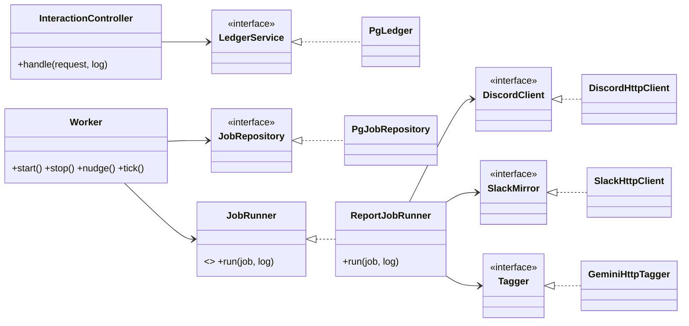

**Functions or classes.** Stateless logic (signature, router, rules, retry, reply builders) is plain exported functions: input in, value out, tested by calling them. Anything holding collaborators or state is a class with constructor injection, typed against a port.

**SOLID, where it carries weight.**
- **Dependency inversion:** controller, worker and runner depend on interfaces owned by `ports/`; adapters implement them.
- **Interface segregation:** ports are narrow and role-shaped (`SlackMirror.send`, `Tagger.tag`); the worker sees `JobRepository`, not session or rule methods.
- **Single responsibility:** `PgLedger` changes when the outbox write changes; `DiscordHttpClient` changes when Discord's API does.
- **Open/closed:** rules are data; a new rule option is a schema field and a branch in `evaluate`, not an edit to the controller. A new job type is a new `JobRunner`.
- **Liskov:** in-memory fakes replace the pg and HTTP adapters in unit tests without the orchestrators noticing.

**Composition root, no DI container.** `index.ts` and `compose.ts` wire everything by hand. At this size a container would be ceremony.

**Deliberate deviations.** Each port has one production implementation; the second is the test fake, which is what earns the seam. `PgLedger` writes interaction, action and job as one unit instead of composing three repositories, because that atomicity is the whole point of the outbox.

### 8.3 Rules, actions and shared enums

```typescript
// packages/shared/src/rules.ts: zod .strict(); the rules editor binds to these
export const StatusRuleConfig = z.object({ version: z.literal(1), ephemeral: z.boolean() }).strict();
export const ReportRuleConfig = z.object({
  version: z.literal(1),
  ephemeral: z.boolean(),                          // fixed at defer time
  replyMessage: z.string().trim().min(1).max(300), // plain text
  mirror: z.boolean(),                             // Slack notification
  tag: z.boolean(),                                // no effect unless LLM_ENABLED
}).strict();
export const DEFAULT_RULES = {
  status: { version: 1, ephemeral: true },
  report: { version: 1, ephemeral: true, replyMessage: 'Report logged. The team has been notified.',
            mirror: true, tag: false },
} as const;

// domain/rules.ts: pure
export function validateRule(command: string, json: unknown): { ok: true; rule } | { ok: false; fields: string[] };
export function evaluate(command: string, ctx: { enabled: boolean }, rule: unknown | null): Action;

export type Action =
  | { type: 'unknown_command' }
  | { type: 'disabled' }
  | { type: 'status'; ephemeral: boolean }
  | { type: 'report'; ephemeral: boolean; replyMessage: string; mirror: boolean; tag: boolean };
```

Rule config is a schema per command, so `/status` never carries fields it cannot use and the editor shows only controls that do something. `enabled` is its own column: it is a switch, not config. No row means enabled with the defaults.

Every enum is an `as const` tuple in `packages/shared/src/enums.ts` **and** a `CHECK` constraint in the migration; a test reads the constraints back from the live database and fails if they drift.

| Enum | Values |
|---|---|
| JobStatus | pending, processing, done, dead |
| JobKind | report, component |
| AttemptTarget | tag, mirror, followup, fallback |
| AttemptOutcome | success, retryable, fatal |
| InteractionStatus | answered, deferred, followed_up, fallback_posted, failed |
| ActionType | report, status, disabled, unknown_command, acknowledged, escalated |
| MirrorStatus | pending, sent, failed, skipped |
| ReportTag | outage, bug, security, abuse, question, feedback, other (plus `untagged` when no tag was obtained) |

---

## 9. Data model and database schema

PostgreSQL is the only store. Schema changes are numbered, forward-only `.sql` files, each applied in one transaction by a small runner that records applied files in `schema_migrations`. Data access is plain parameterised SQL through `pg`, with no ORM: the statements that carry the design (`ON CONFLICT … RETURNING`, `FOR UPDATE SKIP LOCKED`) stay visible.

### 9.1 Entity relationships

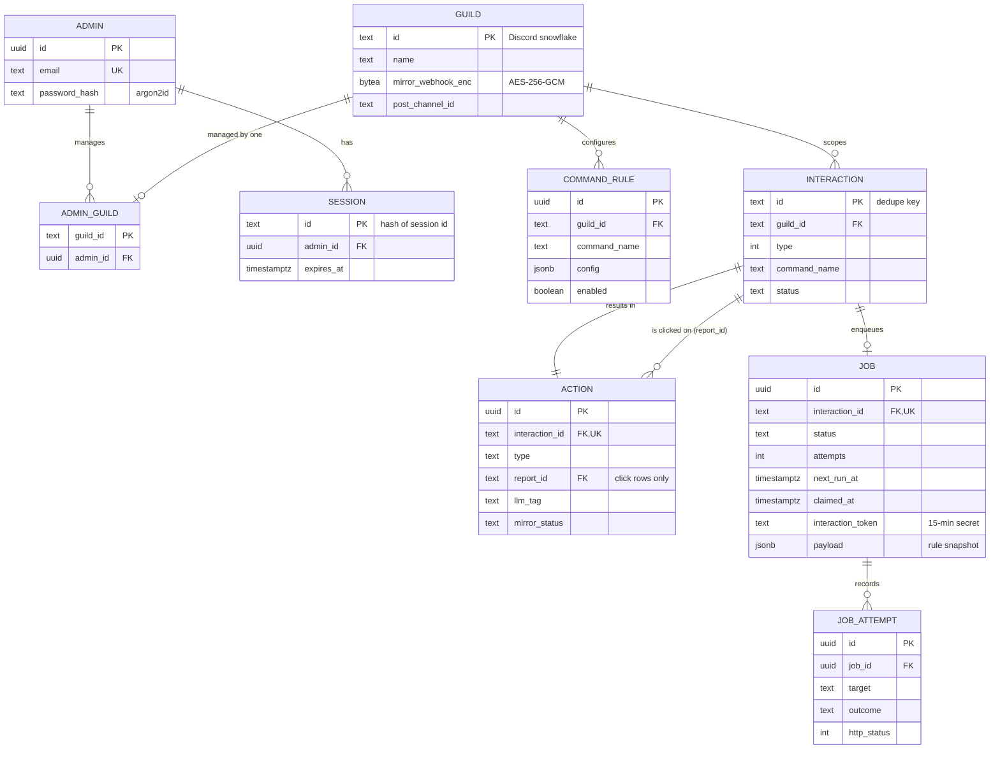

`WORKER_HEARTBEAT` (one row, `id`, `beat_at`) and `schema_migrations` stand alone.

### 9.2 Tables

**`guild`**: a Discord server the bot has seen. Created on the first interaction from it; name, channel and webhook stay NULL until an admin sets them.

| Column | Type | Constraints | Notes |
|---|---|---|---|
| id | text | PK | Discord snowflake (strings, never JS numbers) |
| name | text | | |
| mirror_webhook_enc | bytea | | `version(1) ‖ iv(12) ‖ tag(16) ‖ ciphertext`, guild id as associated data |
| post_channel_id | text | | Channel for the bot-token fallback; if NULL the fallback uses the command's own channel |
| created_at | timestamptz | NOT NULL default now() | |

**`admin`**: dashboard users.

| Column | Type | Constraints |
|---|---|---|
| id | uuid | PK, default `gen_random_uuid()` |
| email | text | NOT NULL, UNIQUE |
| password_hash | text | NOT NULL (argon2id) |
| created_at | timestamptz | NOT NULL default now() |

**`admin_guild`**: which admin manages which server. **Primary key is `guild_id` alone**, so the database guarantees at most one managing admin per server (first claim wins, migration 003). `admin_id` references `admin` with an index for "my servers". Both FKs cascade on delete.

**`session`**: `id text PK` stores a **hash** of the session id (the cookie holds the raw value), `admin_id uuid FK → admin ON DELETE CASCADE`, `expires_at timestamptz NOT NULL`, indexed for cleanup.

**`interaction`**: one row per actionable interaction. Its primary key is the dedupe key.

| Column | Type | Constraints | Notes |
|---|---|---|---|
| id | text | **PK** | Discord interaction id |
| guild_id | text | NOT NULL FK → guild | |
| channel_id | text | NOT NULL | |
| user_id | text | NOT NULL | |
| type | integer | NOT NULL | 2 command, 3 button, 5 modal submit |
| command_name | text | | NULL for button clicks |
| custom_id | text | | button or modal id; never shown on the dashboard |
| options | jsonb | | command options; never the token |
| status | text | NOT NULL, CHECK ∈ InteractionStatus | what the user ended up seeing |
| created_at | timestamptz | NOT NULL default now() | |

**`action`**: what the bot decided, plus the worker's step markers.

| Column | Type | Constraints | Notes |
|---|---|---|---|
| id | uuid | PK | |
| interaction_id | text | NOT NULL, **UNIQUE**, FK → interaction | one action per interaction |
| guild_id | text | NOT NULL FK → guild | |
| type | text | NOT NULL, CHECK ∈ ActionType | |
| report_id | text | FK → interaction; CHECK: set **only** for acknowledged/escalated | the report a click acts on |
| summary | text | | |
| llm_tag | text | | step marker: NOT NULL means tagging is done |
| mirror_status | text | NOT NULL, CHECK ∈ MirrorStatus | step marker: `sent` means mirrored |
| created_at | timestamptz | NOT NULL default now() | |

**`job`**: the outbox and work queue. One job per interaction.

| Column | Type | Constraints | Notes |
|---|---|---|---|
| id | uuid | PK | |
| interaction_id | text | NOT NULL, **UNIQUE**, FK → interaction | |
| guild_id | text | NOT NULL FK → guild | |
| kind | text | NOT NULL, CHECK ∈ JobKind | |
| interaction_token | text | | 15-minute secret; own column, never indexed, cleared on finish |
| token_expires_at | timestamptz | | received time + 15 min |
| status | text | NOT NULL default `pending`, CHECK ∈ JobStatus | |
| attempts | integer | NOT NULL default 0 | passes started, incremented by the claim |
| next_run_at | timestamptz | NOT NULL default now() | when the job is next due |
| claimed_at | timestamptz | | the lease timestamp |
| last_error | text | | human-readable reason, no URLs or tokens |
| payload | jsonb | NOT NULL default `{}` | rule snapshot + report text + user id; no credentials |

**`job_attempt`**: one row per outbound call, append-only history.

| Column | Type | Constraints |
|---|---|---|
| id | uuid | PK |
| job_id | uuid | NOT NULL FK → job ON DELETE CASCADE |
| attempt_no | integer | NOT NULL |
| target | text | NOT NULL, CHECK ∈ AttemptTarget |
| outcome | text | NOT NULL, CHECK ∈ AttemptOutcome |
| http_status | integer | |
| error | text | readable reason, no secrets |
| started_at, finished_at | timestamptz | |

**`command_rule`**: per-server, per-command configuration. `id uuid PK`, `guild_id FK → guild ON DELETE CASCADE`, `command_name` CHECK ∈ (`status`, `report`), `config jsonb NOT NULL`, `enabled boolean NOT NULL default true`, `updated_at`, **UNIQUE (guild_id, command_name)**.

**`worker_heartbeat`**: `id text PK`, `beat_at timestamptz NOT NULL`. Upserted every tick; read by `/status` and `/healthz`.

### 9.3 The constraints that carry the design

| Constraint | What it guarantees |
|---|---|
| `interaction.id` primary key | Deduplication. `INSERT … ON CONFLICT (id) DO NOTHING RETURNING id`: a row back means this delivery won; no row means a duplicate. Never SELECT-then-INSERT, which races. |
| `job.interaction_id` UNIQUE, inserted in the same transaction | The outbox: the intent to do slow work is durable before Discord is answered. |
| `action.interaction_id` UNIQUE | One decision per interaction; the step markers have exactly one home. |
| `admin_guild` PK on `guild_id` | One managing admin per server, enforced under concurrency. |
| `action (report_id, type)` partial unique index | A report is acknowledged at most once and escalated at most once, however clicks race. |
| CHECK constraints on every enum column | The code cannot invent a status the dashboard does not understand. |

### 9.4 Indexes

`job (status, next_run_at)` for the claim; `interaction (guild_id, created_at DESC)` for the log; `job_attempt (job_id, attempt_no)` for history; `session (expires_at)` for cleanup; `admin_guild (admin_id)` for "my servers"; unique `command_rule (guild_id, command_name)`; partial unique `action (report_id, type) WHERE report_id IS NOT NULL`.

### 9.5 Migrations

| File | Change |
|---|---|
| `001_init.sql` | All core tables, CHECK constraints and indexes |
| `002_job_payload_heartbeat.sql` | `job.payload` (rule snapshot) and `worker_heartbeat` |
| `003_admin_guild_single_owner.sql` | `admin_guild` primary key becomes `guild_id` alone (first claim wins) |
| `004_report_click_actions.sql` | `action.report_id`, its CHECK, and the unique `(report_id, type)` index |

### 9.6 Data decisions

- **Unknown servers are accepted.** The ledger transaction starts with `INSERT INTO guild (id) … ON CONFLICT DO NOTHING`, so `/status` works the moment the bot is invited, before any admin connects the server. Tenancy is safe because dashboard access comes only from `admin_guild`.
- **What is recorded.** Every actionable interaction in a server gets an interaction row and an action row. Only deferred `/report` work also gets a job. PINGs, rejected requests, duplicates, DMs, modal opens and invalid submits are not stored.
- **Duplicates on the fast path** are not recorded again but still get a normal reply, because a status read is safe to repeat.
- **Connecting a server** is one statement: insert into `admin_guild` `ON CONFLICT (guild_id) DO UPDATE … WHERE admin_id = EXCLUDED.admin_id RETURNING`. A free server is claimed; the same admin claiming again gets 200; a server someone else manages returns no row and a 404, identical to "no such server". Residual weakness: nothing yet proves the admin owns that Discord server (Appendix C).
- **The interaction token** lives only in `job.interaction_token`, is never logged, indexed or copied into JSON, and is cleared when the job finishes or the follow-up fails fatally.
- **Secrets at rest.** The per-server Slack URL must be stored because each admin sets their own. It is AES-256-GCM encrypted with a key from env, with the guild id as associated data, so a ciphertext copied to another server's row fails to decrypt. Bot token, public key, Gemini key and the encryption key are env-only.
- **"Today"** in `/status` is the current UTC day.
- **Retention.** Interaction ids are kept indefinitely (they are the dedupe record). Pruning old `done` jobs and the report text in their payload is listed under Appendix C.

---

## 10. Sequence diagrams

### 10.1 Endpoint check: PING and forged requests

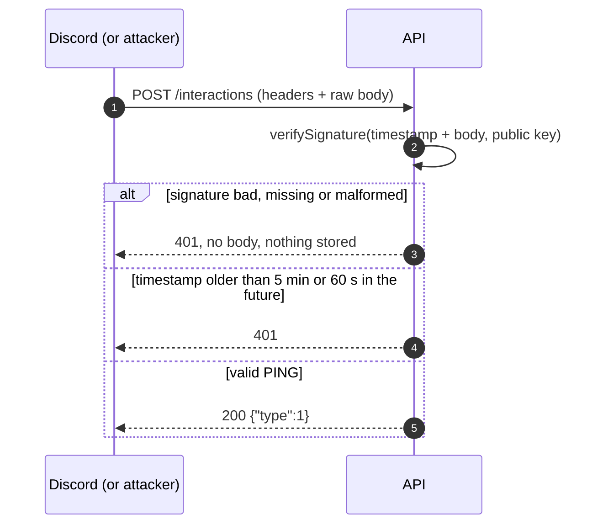

### 10.2 `/report` from command to edited reply

*The main flow, with the two failure branches that matter: Slack down and the reply no longer editable.*

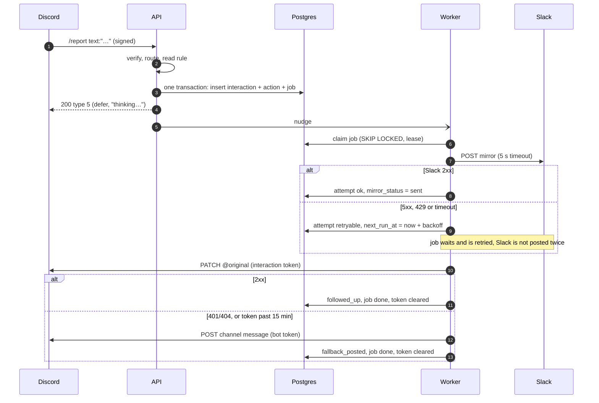

The modal variant differs only at the start: `/report` without text gets a type 9 modal and stores nothing; the submit is a new interaction that follows this diagram from step 2.

### 10.3 The same interaction delivered twice at once

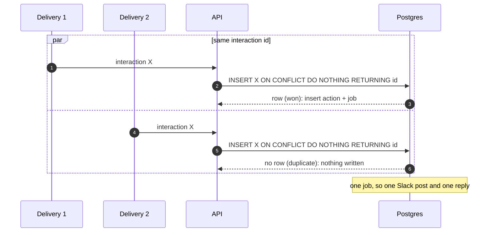

### 10.4 An admin tries to read another server (IDOR)

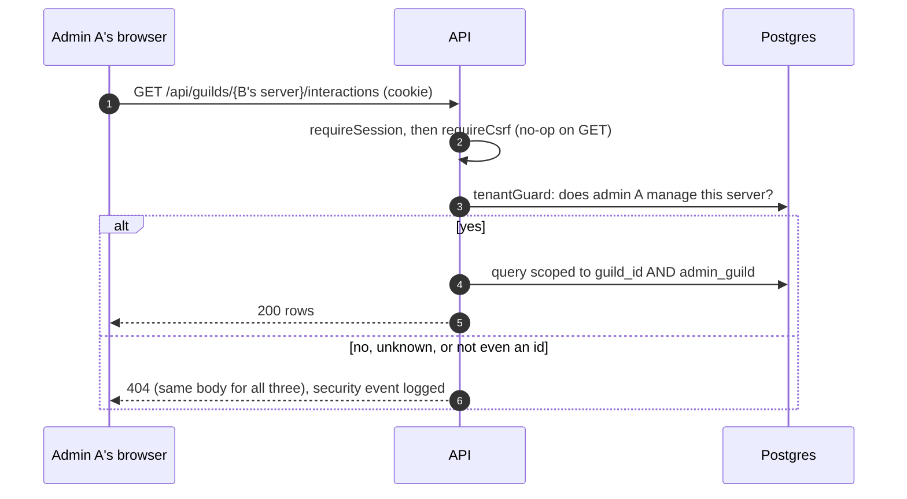

The read query is also joined to `admin_guild` inside SQL, so a missing guard check would still return nothing. Two locks, each tested on its own.

### 10.5 Button click

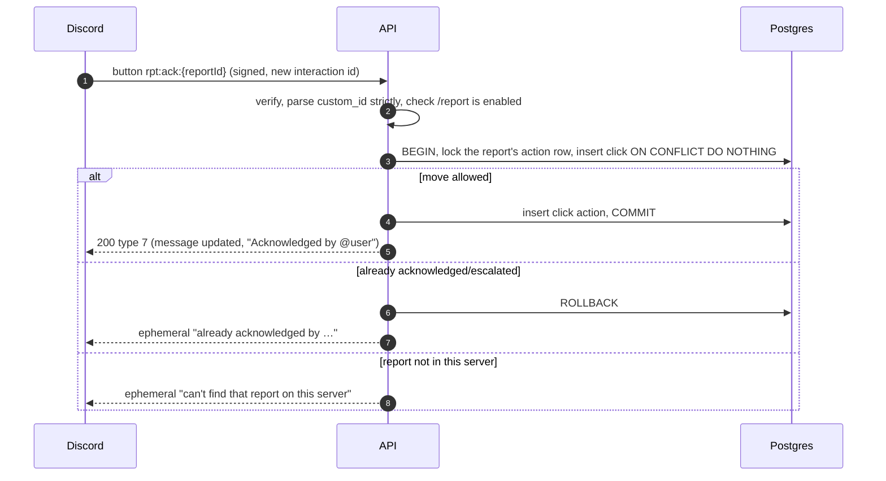

---

## 11. State machines

### 11.1 Job lifecycle

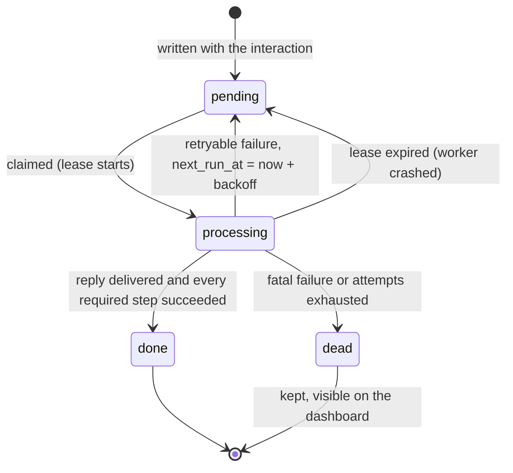

The claim is one statement: select due jobs (`pending` with `next_run_at <= now`, or `processing` with an expired lease) `FOR UPDATE SKIP LOCKED`, stamp `claimed_at`, increment `attempts`, and return them, committed before any network call. Every later write is guarded by that `claimed_at`, so a worker that lost its lease cannot overwrite the new owner's work.

### 11.2 Interaction status

| Stored status | Meaning |
|---|---|
| `answered` | Replied inline (status, notices, button updates) |
| `deferred` | "Thinking…" shown; the worker has not finished |
| `followed_up` | Reply edited with the result |
| `fallback_posted` | Reply impossible; a channel post was made instead |
| `failed` | Nothing reached the user (fallback also failed) |

Rejected, PING and duplicate requests are never stored, so they have no status.

### 11.3 The report job: four ordered, idempotent steps

| # | Step | Skipped when | On success | On failure |
|---|---|---|---|---|
| 1 | **Tag** (rule `tag` and `LLM_ENABLED`) | `llm_tag` is set | write the tag | write `untagged`, record a fatal attempt, continue. Never retried, never blocks the mirror |
| 2 | **Mirror** to Slack (rule `mirror`) | `mirror_status` is `sent`, `skipped` or `failed` | `mirror_status = sent`, commit at once | retryable: back to `pending` with backoff. Fatal: `mirror_status = failed`, continue so the user still gets an answer |
| 3 | **Follow-up** `PATCH @original` | token cleared or expired | clear token, interaction `followed_up`, finish | retryable: back to `pending`. 401/404 or any fatal: clear token, go to step 4 now |
| 4 | **Fallback** bot-token post to the server's post channel, or the channel the command ran in if none is set | | interaction `fallback_posted`, finish | retryable: back to `pending` (steps 1 to 3 skip themselves). Fatal (for example 403, the bot lacks Send Messages): job `dead`, interaction `failed` |

**Finish rule.** The job is `dead` if the mirror failed, otherwise `done`. The interaction status says what the user saw; the job status says whether every required step worked. So "reply delivered, Slack webhook broken" ends as interaction `followed_up`, job `dead`: the user was answered, and the broken webhook shows up on the dashboard where the admin can fix it.

**Why it never does anything twice.** Each step's marker is committed together with its attempt row immediately after the call, before the next call. A retried pass reads the markers and skips finished steps. The one gap: if Slack accepts a post and the process dies before the `sent` marker commits, the retry posts again. Slack webhooks offer no idempotency key, so this is documented rather than hidden (Appendix C).

**The fallback is public**, so it never contains the report text when the rule was ephemeral: it says "@user, your report was logged (ref …)". It never shows the tag or carries buttons either.

**Tagging details.**
- Fixed tag set in `packages/shared`: `outage, bug, security, abuse, question, feedback, other`. `other` means the model found nothing fitting; `untagged` means no tag was obtained. Different facts, different values.
- Call: `POST {base}/models/{model}:generateContent` with the key in the `x-goog-api-key` header (never the URL), `responseMimeType: application/json` and a `responseSchema` restricting the answer to the enum [G1]. The answer is validated against the enum again in code: a schema is a request, not a guarantee.
- The request contains the instruction and the report text inside `<report>` tags, nothing else: no user, server or token. No redirects followed, response body capped at 16 KiB, 8 s timeout.
- Default model `gemini-3.5-flash-lite`, overridable with `GEMINI_MODEL`. The adapter sits behind `Tagger`, so a provider change is one file.
- Model output can only ever become one of seven words on a label. It never drives an action.
- The tag appears on the dashboard and in the Slack line, never in Discord (the fallback is public, and a tag would reveal what a private report was about).
- **Not yet exercised against the live API**: only stubs were used in development.

### 11.4 Why a follow-up 401/404 is fatal, not retried

A 401 or 404 from the webhook route inside the 15 minutes is deterministic (the 3-second ACK was missed, or the application id is wrong), so retrying repeats it up to `MAX_ATTEMPTS` times. Discord counts 401, 403 and 429 responses towards its invalid-request limit, which ends in a temporary IP ban for the whole bot [D5]. Treating it as fatal and going straight to the channel fallback keeps `classifyFailure` a simple status classifier, answers the user immediately instead of after 15 minutes, and sends no extra traffic towards the ban.

---

## 12. Design patterns used

Each pattern is listed with the problem it solves here and what it costs. Patterns with no problem to solve were left out on purpose (end of section).

### 12.1 Architectural

| Pattern | Where | Problem it solves | Cost |
|---|---|---|---|
| **Modular monolith** | one deployable, folders with lint-enforced boundaries | Simple to run and deploy, still split-able | Discipline needed to keep boundaries |
| **Hexagonal / Ports and Adapters** | `ports/` + `adapters/` | Test verify, dedupe and retry without a network; swap Slack, LLM or host | Interfaces and wiring |
| **Layered dependency rule** | `http → app → domain`, enforced by ESLint | Pure core, frameworks at the edge | Some indirection |
| **Composition root** (manual DI) | `index.ts`, `compose.ts` | One place where concrete classes are chosen | Hand-written wiring |
| **Shared kernel** | `packages/shared` | One definition of enums and schemas for API, UI and DB | A third package to version |

### 12.2 Reliability and integration

| Pattern | Where | Problem it solves | Cost |
|---|---|---|---|
| **Transactional outbox** | `PgLedger`, `job` table | Persist the intent to do slow work atomically with the record, before answering Discord | Extra table and a drainer |
| **Idempotent consumer** | `interaction.id` PK + `ON CONFLICT DO NOTHING` | Discord may deliver the same interaction more than once | A "duplicate" branch |
| **Competing consumers with SKIP LOCKED** | `PgJobRepository.claim` | Several workers can claim jobs without collisions | Postgres-specific SQL |
| **Lease** (visibility timeout) | `job.claimed_at`, `LEASE_MS` | A crashed worker's jobs come back automatically | Lease bookkeeping, guarded writes |
| **Retry with exponential backoff and full jitter** | `domain/retry.ts` | Transient 5xx/429/timeouts without a thundering herd | Scheduling state |
| **Retry-After honoured** | `retryDelayMs` | Avoid repeated 429s and the Discord IP ban | None |
| **Error classification** (retryable vs fatal) | `classifyFailure` | One decision point, so nobody re-classifies inline | A table to keep honest |
| **Idempotent step pipeline with checkpoints** | `ReportJobRunner`, markers on `action` | A retried job skips finished steps: no double Slack post, no double tag | Marker columns |
| **Timeout on every outbound call** | `adapters/httpCall.ts` (`AbortSignal.timeout`) | A hung call cannot hold a job for ever | Tuning per target |
| **Bulkhead** | separate request and worker DB pools | Slow worker queries cannot starve the 3-second path | More connections |
| **Graceful degradation / fallback** | channel fallback, `untagged`, "not logged" notice | The user always gets an honest answer | Extra paths to test |
| **Snapshot at enqueue** | `job.payload` | A rule edited mid-flight cannot change an in-progress report | Payload copy |
| **Health endpoint + heartbeat** | `/healthz`, `worker_heartbeat` | Detect a dead DB or stopped worker; keep-warm target | One query, cached 5 s |

### 12.3 Code-level (GoF and friends)

| Pattern | Where | Why |
|---|---|---|
| **Adapter** | every class in `adapters/` | Turn `fetch`, `pg` and `node:crypto` into port-shaped calls |
| **Strategy** | `Worker` → `JobRunner` interface → `ReportJobRunner` | The loop does not know what a job does; a new job kind is a new runner |
| **Repository** | `PgJobRepository`, `PgAdminRepository`, `PgSessionRepository` … | Persistence behind an aggregate-shaped interface |
| **Front controller** | `InteractionController` | One entry point owns the fixed order: verify, replay check, parse, route, rule, record, reply |
| **Chain of responsibility** | Express middleware: request context → security headers → session → CSRF → tenant guard; Angular HTTP interceptors | Cross-cutting checks in a fixed, testable order |
| **Rules as data** (table-driven policy) | `command_rule.config` + `evaluate` | Behaviour changes without a deploy, validated by zod |
| **Result type** instead of exceptions | `CallResult`, `TagResult`, `ClickOutcome`, `RouteDecision` | Expected failures are values the compiler forces callers to handle |
| **State machine** | job status, report state, interaction status | Allowed moves are explicit and enforced in SQL |
| **Builder / factory functions** | `discordResponses.ts`, `reportReplies.ts` | One place applies the 2000-char cut and the no-ping rule |
| **Observer (signals)** | Angular stores | Components react to state changes instead of polling their own calls |

### 12.4 Security patterns

Verify before parse; fail closed (unknown error → exit or 500, never "allow"); defence in depth (tenant guard **and** tenant-scoped SQL); least privilege (bot permissions 3072, per-agent write scopes); secrets as configuration, never code; same-origin cookie session with CSRF tokens; allow-listed outbound URLs.

### 12.5 Considered and not used

Saga (no multi-service transaction), CQRS and event sourcing (no read/write divergence), circuit breaker (backoff is enough at this rate; add if a dependency flaps), message broker (Postgres is enough, ADR-0001), DI container (manual wiring is clearer at this size), ORM (would hide the SQL that matters).

---

## 13. Threat model (STRIDE)

**Assets:** bot token; interaction tokens; Slack webhook URLs; Gemini key; admin credentials and sessions; per-server data; availability of the interactions endpoint. Flows refer to §2.4.

| ID | Flow | STRIDE | Threat | Mitigation | Residual |
|---|---|---|---|---|---|
| T-01 | 1 | Spoofing | Forged or unsigned interaction | Ed25519 verify on every request before parsing → 401 | None meaningful |
| T-02 | 1 | Tampering | Body altered | Signature covers the raw bytes; TLS | None |
| T-03 | 1 | Replay | Captured valid request resent | Timestamp at most 5 min old and 60 s ahead, checked after the signature; dedupe as backstop | One replay inside the window, absorbed by dedupe |
| T-04 | 1 | DoS | Flood of junk | Cheap verify, 100 KiB body cap, early reject, bounded worker | Volumetric attacks (host or CDN concern) |
| T-05 | 1 | Elevation | Crafted `custom_id` | Parsed strictly; report looked up in the signed server only | None |
| T-06 | 2 | Spoofing | Forged dashboard request (CSRF) | `HttpOnly; Secure; SameSite=Lax` `__Host-` cookie, CSRF token on every mutation, same origin | None |
| T-07 | 2 | Brute force | Password guessing | argon2id; 5 attempts per IP+email and 20 per IP per minute; equal timing for unknown emails | Throttle is per process |
| T-08 | 2–3 | Elevation | Admin A reads server B (IDOR) | `tenantGuard` plus `admin_guild` join in SQL; same 404 for every miss | None |
| T-09 | 5–6 | Disclosure | Secret in logs or client | pino `redact` paths, token in its own column, no secrets in the bundle, write-only webhook field | None |
| T-10 | 1 | Repudiation | "I never ran that" | Append-only interaction and attempt rows; interaction id as correlation id | None |
| T-11 | 5 | Tampering (LLM) | Report text steers the model | Output restricted to a 7-word enum, validated in code, never drives an action | None |
| T-12 | 5 | SSRF | Admin sets a webhook pointing inside the network | URL must start with `https://hooks.slack.com/services/`; redirects not followed | None |
| T-13 | 1, 2 | Injection | Mention spam, log injection, reflected input | `allowed_mentions: {parse: []}`; errors return schema field paths only, never caller text | None |
| T-14 | 2 | Disclosure | Clickjacking, content sniffing | Security headers incl. CSP `frame-ancestors 'none'`, `no-store` on `/api` | None |

**Replay window.** Discord's signature proves origin, not freshness, and the docs give no window, so 5 minutes is our choice: it covers clock skew and network delay while bounding replays. Future timestamps get only 60 s, since Discord stamps a request when it sends it and a far-future stamp cannot come from a fresh request. Malformed timestamps get the same bare 401.

**Derived security requirements.** SR-1 verify before parse, 401 on failure, never 500 on malformed input. SR-2 reject stale timestamps. SR-3 dedupe through a database constraint. SR-4 every dashboard query tenant-scoped with an object-level check. SR-5 secrets never in repo, bundle or logs. SR-6 CSRF on mutations, argon2id, login throttle.

---

## 14. Failure handling and observability

| Integration | Failure | Behaviour |
|---|---|---|
| Discord inbound | bad, missing or malformed signature | 401, nothing stored, never 500 |
| Discord inbound | PING | 200 `{type:1}` |
| Postgres on the request path | down or slower than the budget | Ephemeral "not logged" within 3 s; never a fake success |
| Discord follow-up | 401/404 | Fatal; clear token; channel fallback in the same pass (§11.4) |
| Discord follow-up | 429 | Retry no earlier than `Retry-After` |
| Discord follow-up | 5xx, timeout | Retry with backoff |
| Channel fallback | 403 (missing permission) or other 4xx | Fatal; job `dead`, interaction `failed`, reason on the dashboard |
| Slack mirror | 5xx, 429, timeout | Retry with backoff and jitter; 429 honours `Retry-After` |
| Slack mirror | other 4xx, bad URL, undecryptable webhook | Fatal; `mirror_status = failed`; user still gets the reply; job ends `dead` |
| Slack mirror | 2xx but the marker never committed | Retry posts again: the one documented duplicate (Appendix C) |
| Gemini | anything but a valid enum answer | `untagged`, one try, mirror continues |
| Worker | crash mid-job | Lease expires, job is claimed again; nothing lost |
| Worker | DB down | Ticks back off to 30 s; heartbeat goes stale; `/healthz` returns 503 |

**Logs.** Structured JSON through pino. A child logger carries `interaction_id` (and `job_id` in the worker) from receipt to final reply, so one id finds every line. Redaction is configuration (`redact` paths for tokens, cookies, authorization headers, passwords, webhook URLs, API keys), not a sanitiser someone must remember to call. Security events (`logType: "security"`: rejected signatures, denied tenant access, config changes) are separate from operational events.

**History on the dashboard.** Every interaction shows its action, tag state, mirror state and a timeline of `job_attempt` rows: which call (tag, mirror, followup, fallback), the HTTP status, and a readable reason.

**Health.** `GET /healthz` is unauthenticated and returns only `{status, db, worker}`. It runs one primary-key query bounded by 2 s, reports 503 if the database does not answer or the heartbeat is older than `LEASE_MS`, allows a start-up grace of one lease, and caches its answer for 5 s so a flood of probes is one query. A keep-warm pinger on this endpoint also wakes a suspended hosted database.

**What to alert on** once hosted: dead-job count rising, pending backlog not draining, `/healthz` failing.

---

## 15. Architecture Decision Records

Scoring weights follow the quality priority (§1.3): Security 0.30, Reliability 0.30, Responsiveness 0.20, Simplicity 0.20. Scores are 1 to 5; totals are weighted, out of 5.

### ADR-0001: Durable work through a transactional outbox in Postgres

- **Status:** Accepted, 2026-10-11
- **Context:** NFR-03 (nothing lost) and NFR-02 (exactly once) after a 3-second ACK.
- **Decision:** write the interaction, action and job rows in one transaction before answering Discord; a worker drains jobs with `FOR UPDATE SKIP LOCKED`, retries with backoff, and records attempts.

| Option | Pros | Cons | Score |
|---|---|---|---|
| **Outbox in Postgres (chosen)** | Atomic; one store; crash-safe | Postgres-specific SQL; own the drainer | **4.6** |
| Redis + BullMQ | Mature queue, built-in backoff | Second datastore; dual write loses atomicity | 3.3 |
| In-memory queue | Zero infrastructure | Lost on restart, fails NFR-03 | 1.6 |

- **Revisit when:** sustained load above about 50 jobs per second, or fan-out to other services. Then add a broker fed from the outbox.

### ADR-0002: One deployable with an in-process worker, split-able later

- **Status:** Accepted, 2026-10-11
- **Decision:** one process runs the HTTP server and the worker loop. `WORKER_MODE=standalone` runs the same worker with no server, and `SKIP LOCKED` makes several instances safe.

| Option | Pros | Cons | Score |
|---|---|---|---|
| **Single deployable (chosen)** | One thing to deploy; real seam | A busy worker could compete for the event loop (not at this load) | **4.5** |
| Separate API and worker services | Independent scaling | Two deploys, no benefit here | 3.6 |
| Serverless + cron/queue | No server | Cold starts against the 3 s window | 2.8 |

### ADR-0003: Email and password (argon2id) with a database session cookie

- **Status:** Accepted, 2026-10-11
- **Decision:** argon2id hashes; a random opaque session id in an `HttpOnly; Secure; SameSite=Lax` cookie with the `__Host-` prefix; only a hash of the id is stored; CSRF token on mutations; `seed-admin` creates the account.

| Option | Pros | Cons | Score |
|---|---|---|---|
| **Password + DB session (chosen)** | Simple, revocable, nothing secret in JS | Session table to sweep | **4.4** |
| JWT in cookie or localStorage | Stateless | Hard to revoke; localStorage is readable by XSS | 3.2 |
| Discord OAuth2 only | Real identity, can prove server ownership | Client secret and full flow; more to build | 3.4 |

- **Consequence for hosting:** the SPA and the API **must share one origin**. A `SameSite=Lax` cookie is not sent on cross-site fetches, and platform domains such as `*.onrender.com` and `*.vercel.app` are on the Public Suffix List, so even two subdomains count as cross-site. Express therefore serves the Angular build. No CORS.
- **Revisit when:** admins should sign in with their Discord identity, which also closes the first-claim weakness (Appendix C).

### ADR-0004: Node.js, TypeScript and Express for the API

- **Status:** Accepted, 2026-10-11
- **Context:** the team's strongest stack is Node/TypeScript; the one tricky part is raw-body handling on a single route.
- **Decision:** Express 5, `express.raw()` on `/interactions` only. Domain and app code import no Express, so moving framework touches only `http/`.
- **Rejected:** Fastify (better schema validation, but less familiar, for no requirement); NestJS (too much ceremony at this size).

### ADR-0005: pino for structured logging with redaction

- **Status:** Accepted, 2026-10-11
- **Decision:** pino, JSON by default, `redact` paths as configuration, child loggers for correlation.

| Option | Pros | Cons | Score |
|---|---|---|---|
| **pino + redact (chosen)** | Fast; redaction is a built-in option | Paths must track the schema | **4.6** |
| winston | Flexible transports | Redaction bolted on | 3.6 |
| console.log + sanitiser | No dependency | Easiest to get wrong exactly where it matters | 2.2 |

### ADR-0006: Live log by polling, not server-sent events

- **Status:** Accepted, 2026-10-12
- **Context:** F-13 asked for live updates. Several free hosts and proxies buffer or cut long-lived streams.
- **Decision:** the dashboard re-fetches the first page every 5 seconds and merges by id, backing off on errors.
- **Consequences:** up to 5 s of delay; negligible load at this scale; nothing to break on a buffering proxy.
- **Revisit when:** a host is chosen that streams unbuffered; SSE with polling as the fallback.

### ADR-0007: Ed25519 verification with `node:crypto`, not `discord-interactions`

- **Status:** Accepted, 2026-10-11
- **Context:** the contract is a synchronous `verifySignature(...): boolean`. `discord-interactions`' `verifyKey` returns a Promise; an un-awaited Promise is truthy, which would accept every forged request.
- **Decision:** `crypto.verify(null, message, key, signature)` with the raw 32-byte key wrapped as SPKI DER. Zero dependencies, synchronous, and tested against tampered body, tampered timestamp, wrong key, bad hex and an invalid curve point.

---

## 16. Build plan and verification

Built in six steps, riskiest first, each with WHEN/SHALL acceptance criteria turned into tests before code.

| Step | Goal | Key acceptance criteria | Status |
|---|---|---|---|
| 1 | Verified endpoint accepted by Discord | PING answered; bad signatures 401, never 500; `/status` within 3 s | Done |
| 2 | Record, dedupe, outbox | 10 concurrent identical deliveries → one row, one job; job committed before the ACK | Done |
| 3 | Defer, worker, Slack mirror, follow-up | Slack 500 then 200 → one post, attempts recorded; token expiry → channel fallback; follow-up 401 → exactly one PATCH and one fallback; no Slack call repeated after success | Done |
| 4 | Dashboard, auth, tenant isolation | Unauthenticated → 401; admin A on server B → 404; log shows each command, action and attempt history | Done |
| 5 | Modal, buttons, rules as data | Modal round trip; button updates the message; bad rule refused on save; corrupt stored rule falls back and does not crash | Done |
| 6 | LLM tag, hardening, docs | LLM failure still mirrors; stale timestamp rejected; no secrets in repo or bundle | Done (Gemini not yet called live) |
| 7 | Public deployment | Live URL passes the checklist in Appendix A | **Pending** |

### 16.1 Test strategy

| Layer | What | How |
|---|---|---|
| Pure domain | signature, router, rules, retry, reply builders | Vitest unit tests; self-generated Ed25519 keypair signs test payloads |
| Database | ledger atomicity, 10-way concurrent dedupe, claim and lease, click state machine, tenant SQL | Integration tests against real PostgreSQL; failures injected in the DB (`CHECK (false) NOT VALID`) rather than through guessed bad input |
| HTTP | routes, middleware, auth, CSRF, IDOR | Supertest against `createServer` (the app is built without listening) |
| Worker scenarios | Slack/Discord/Gemini down, slow, 429, 404, flaky | In-process stub servers; downstream base URLs are configurable for exactly this |
| Adversarial | forged, replayed, duplicate, oversized requests; mention injection | `attack.mjs` and `stub-downstream.mjs`, run by the quality-verifier agent (§17) |
| Test quality | Would the tests fail if the code were wrong? | Manual mutation passes on retry and tenant code: break the code, confirm the right test fails |
| Dashboard | stores, guards, polling, a11y | Angular unit specs, an a11y spec, and the production build driven in a real browser |
| Contract drift | enums in code vs CHECK constraints in the DB | A test reads the constraints from the live database |

### 16.2 Design proposals raised during the build

Implementers could not change this document; they raised proposals, which were reviewed and merged.

| # | Proposal | Outcome |
|---|---|---|
| 0001 | Follow-up 401/404: retry or fatal? | Accepted: fatal plus immediate fallback (§11.4) |
| 0002 | Rule config shape, `Action`, enums | Accepted with a per-command schema (§8.3) |
| 0003 | Which package owns the shared enums | Accepted: `packages/shared` as a leaf (§7) |
| 0004 | Domain import allow-list must include `node:crypto` | Accepted, for `signature.ts` only |
| 0005 | Step 3 assumptions recorded where a design section was missing | Folded into §9 and §11.3 |

---

## 17. Agent-assisted development: the scaffolding

This section explains how the system was built with AI agents, and how the repository constrains them.

### 17.1 Who did what

- **Design.** Rohan led the design with Claude as a design assistant: requirements, quality priorities, architecture style, data model, ADRs, threat model and the build plan in this document, plus the invariants in `CLAUDE.md`. The decisions that set the shape of the system (outbox in Postgres, single deployable, same-origin session auth, first-claim-wins tenancy, polling over SSE, follow-up 401/404 as fatal) were reviewed and accepted by Rohan.
- **Implementation.** Claude Code agents wrote the code and tests, one build step at a time, from this document.
- **Review and integration.** A main session (the orchestrator) picked each step, delegated it, ran the independent verifier, and Rohan reviewed the diffs and committed one logical change per commit.

### 17.2 The workflow

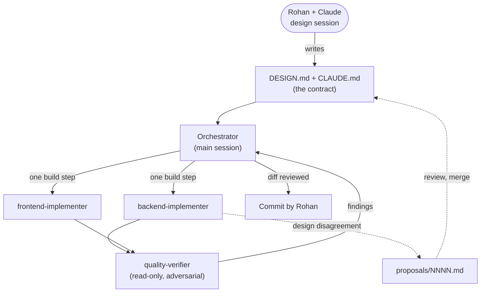

The rule that makes it work: **implementers may not edit the design.** If the design is wrong or silent, they write a proposal and stop. Five proposals came out of the build (§16.2); two of them prevented real defects before any code was written.

### 17.3 Context files

| File | Role |
|---|---|
| `CLAUDE.md` (root) | The non-negotiable invariants (verify first, dedupe in one statement, outbox, 3 s/15 min clocks, retry rules, secrets, tenancy). Always loaded. Imports `docs/agent-workflow.md` |
| `apps/api/CLAUDE.md`, `apps/web/CLAUDE.md` | Per-folder conventions and which skills apply |
| `AGENTS.md` | A pointer for tools that read `AGENTS.md` instead of `CLAUDE.md`, so there is one source of truth |
| `docs/agent-workflow.md` | Repo layout, orchestration steps, the skill and hook tables |
| `architecture/docs/DESIGN.md` | This document: the contract implementers build against |

### 17.4 Agents (`.claude/agents/`)

| Agent | Can write | Skills preloaded | Hooks | Cannot |
|---|---|---|---|---|
| `backend-implementer` | `apps/api`, `packages/shared`, `scripts`, `.env.example`, root package files | contract-first, backend-guidelines, discord-interactions, resilience, security-secrets, observability, user-facing-messages, ai-journal | scope-guard on writes; verify-workspace on stop | spawn agents, edit the design, read `.env`, weaken a security check |
| `frontend-implementer` | `apps/web` | contract-first, frontend-guidelines, state-management, ux-accessibility, user-facing-messages, security-secrets, ai-journal | scope-guard; verify-workspace | spawn agents, touch the backend, add UI libraries without an ADR |
| `quality-verifier` | `docs/verification` only | quality-bar-check, discord-interactions, security-secrets, ai-journal | scope-guard | Edit any code (Edit tools disallowed); it reports, never fixes |

Every agent may also write `docs/ai-journal.md` and `architecture/docs/proposals/NNNN-*.md`, so it can always record a mistake or raise a design issue.

**Why a separate verifier.** The implementer that wrote the code is the worst judge of it. The verifier did not write the code, assumes it is broken, and runs attacks and outage scenarios. It found, for example, a 500 from a calendar-invalid log cursor that every implementer test had missed.

### 17.5 Skills (`.claude/skills/`)

A skill is a folder of instructions an agent loads when its task matches. They encode project rules once instead of repeating them in every prompt.

| Skill | Used by | What it encodes |
|---|---|---|
| contract-first | both implementers | How to read DESIGN.md by section, turn WHEN/SHALL into tests, define done, raise a proposal |
| discord-interactions | backend, verifier | Signature, PING, defer, modal and component traps; an API cheat sheet |
| resilience | backend | Outbox and worker pitfalls, timeouts, retry classification, error model |
| security-secrets | all | Secret inventory, sessions and CSRF, tenant isolation, SSRF, headers, threat model |
| observability | backend | pino and redaction, security vs operational events, health |
| backend-guidelines | backend | Hexagonal layout in practice, validation, DB, testing, TypeScript style and lint |
| frontend-guidelines | frontend | Angular 21 and Material 3 conventions, API client, browser security, testing |
| state-management | frontend | Signal stores, polling, optimistic saves, auth state |
| ux-accessibility | frontend | Four states per screen, live log UX, WCAG 2.2 AA |
| user-facing-messages | both | One voice for Discord replies, Slack lines and the dashboard |
| ai-journal | all | Log every AI wrong turn immediately, in a fixed format |
| quality-bar-check | verifier | `attack.mjs` (forged, replayed, duplicate, oversized), `stub-downstream.mjs` (ok, slow, error, ratelimit, gone, flaky), live checklist |
| free-tier-deploy | orchestrator | No-card hosting, cold starts, same-origin cookies, env vars |

### 17.6 Hooks (`.claude/hooks/` and `.claude/settings.json`)

Hooks are small Node scripts the agent runtime calls before or after a tool runs. They receive the tool call as JSON on stdin; **exit code 2 blocks the call** and the message on stderr goes back to the agent so it can correct itself. They turn rules from "please don't" into "can't".

| Hook | When | Effect |
|---|---|---|
| `settings.json` deny rules | always | Agents cannot read `.env` files at all |
| `secret-scan.mjs` | before any write or edit | Blocks writing `.env*` (except `.env.example`) and any content matching a Discord token, Discord or Slack webhook URL, Google or Groq API key, hosted Postgres URL with a password, or a private key block |
| `guard-bash.mjs` | before any shell command | Blocks reading or staging `.env`, `--no-verify`, force-push, `reset --hard`, `clean -f` |
| `format-on-edit.mjs` | after any write or edit | Runs Prettier on the touched file |
| `scope-guard.mjs` | before writes, per agent | Limits each agent to its own folders |
| `verify-workspace.mjs` | when an agent tries to finish | Runs typecheck, lint and tests for that agent's workspaces; sends it back up to 3 times, then lets it stop but requires it to report the failures |

### 17.7 Feedback loops

- **AI journal** (`docs/ai-journal.md`): every time an agent's assumption or code turned out wrong, it was logged at once with how it was caught and what now prevents a repeat. 38 entries. `AI_NOTES.md` is drawn from it.
- **Proposals** (§16.2): disagreements with the design became reviewable files instead of silent drift.
- **Verification reports** from the quality-verifier, routed back to the owning implementer.

### 17.8 What the scaffolding caught, and what it missed

Caught: an async signature check that would have accepted forgeries (ADR-0007); retrying a deterministic 401 into an IP ban (proposal 0001); validation errors echoing attacker-chosen key names; a 500 on a crafted cursor; a frontend that hung in a real browser despite 200 green unit tests.

Missed until an audit: Step 4 shipped rule editing with green tests, but the bot never read the saved rules. The save tests proved a row was written; nothing proved a row was read. The lesson, now a rule: every "configurable X" feature needs one test that changes X and observes behaviour.

Friction: the bash guard blocked a harmless command that only mentioned `.env` (a safe false positive); per-folder context files drifted from the design once; agents repeatedly lost work to shell quoting on Windows until they switched to file-writing tools.

---

## Appendix A: Deployment

**Target.** Must be free with no card. The process is always-on Node, so:

| Piece | Choice |
|---|---|
| Web service | Render free web service (or any always-on Node host), Node 22, one instance. Builds the Angular app and runs the API from the same deploy |
| Database | Neon or Supabase free Postgres, pooled connection string with `sslmode=verify-full` |
| Keep-warm | Free tiers sleep after idle and take 30 to 60 s to wake, which breaks the 3 s window. A pinger (cron-job.org or a scheduled GitHub Action) calls `/healthz` every 10 minutes |
| Secrets | Host environment variables only. `TRUST_PROXY_HOPS=1` behind Render's proxy so login throttling sees real client IPs |

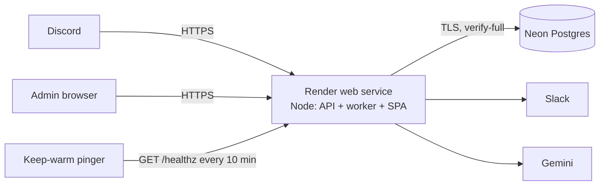

**Do not** host the dashboard on a separate static host while the API runs elsewhere: the session cookie becomes cross-site and login breaks (ADR-0003).

**Go-live checklist.** Run migrations; seed the admin; set the Interactions Endpoint URL in the Developer Portal (Discord sends a PING and a deliberately bad signature, and saves only if both are handled); invite the bot with permissions 3072; register guild commands; connect the server in the dashboard; run `/status`, `/report` with text and with the form, click both buttons; point the webhook at a dead URL and watch retries on the dashboard; run `attack.mjs` against the live URL.

---

## Appendix B: Behaviour under adverse conditions

| Scenario | What happens |
|---|---|
| Same interaction delivered twice, concurrently | One `INSERT … ON CONFLICT DO NOTHING RETURNING id` wins and enqueues; the other gets no row and writes nothing. Both are answered normally |
| Slack down for 10 minutes, 30 reports arrive | All 30 are verified, stored and deferred within 3 s. Their jobs retry with backoff and jitter, visible as retrying on the dashboard, and drain when Slack returns. Nothing lost (outbox), nothing doubled (markers) |
| Forged or unsigned request | 401 before parsing, nothing stored, never 500 |
| Valid request replayed an hour later | Signature passes, timestamp fails: 401 |
| Slow work (LLM, Slack) | Never before the reply. Defer first, worker afterwards, then `PATCH @original` |
| Worker crashes mid-job | The lease expires and the job is claimed again; finished steps skip themselves |
| Follow-up returns 401/404 | Not retried. Token cleared, channel fallback posted in the same pass |
| Downstream returns 400 | Fatal, recorded with a readable reason, visible on the dashboard; the user still gets a reply |
| Database down during a command | Private "we couldn't log that" within 3 s |
| Admin edits a rule while a report is in flight | The report finishes with the rule it started with (snapshot in `job.payload`) |
| Admin A requests admin B's server | 404, identical to a server that does not exist; security event logged |
| Report text tries to manipulate the LLM | The worst outcome is a wrong label from a fixed list of seven |

---

## Appendix C: Known limitations and evolution path

**Known limitations.**
- **Slack mirror is at-least-once in one narrow case.** If Slack accepts a post and the process dies before the `sent` marker commits, the retry posts again. Slack webhooks offer no idempotency key. A crash test reproduced it once.
- **The reply waits for Slack.** The steps run tag → mirror → reply, so while Slack is retrying the user stays on "thinking…", up to the 15-minute token life. Moving the reply before the mirror would fix this at the cost of the "notification failed" warning in the reply.
- **First claim wins.** Connecting a server does not prove Discord ownership; anyone with a dashboard account who knows an unclaimed server's id can claim it. Fine for one seeded admin.
- **Any member can click** Acknowledge/Escalate on a public report. No role check yet.
- **Login throttle is in memory**, per process: a restart clears it and two instances count separately.
- **Gemini has only been tested against stubs.**
- **No retention sweep** yet for old jobs and the report text in their payload.
- **No CI pipeline**: typecheck, lint and tests are enforced by agent hooks and run locally, not on every push.

**Evolution path (what changes, and when).**

| Trigger | Change |
|---|---|
| Real admins beyond one | Discord OAuth2 (`identify` + `guilds`), check `MANAGE_GUILD` before writing `admin_guild`; role check on buttons |
| Worker load competes with the API event loop | Run `WORKER_MODE=standalone` as a second service; no code change |
| Several API instances | Move the login throttle to Postgres; already safe for jobs (`SKIP LOCKED`) |
| Sustained load above about 50 jobs/s or fan-out to other consumers | Add a broker fed from the outbox; Postgres stays the source of truth |
| Interaction table in the millions | Partition `interaction` and `job_attempt` by month; retention job |
| Host that streams without buffering | SSE for the live log, polling as fallback |
| Duplicate Slack posts become unacceptable | Post through Slack's Web API with a client-supplied id, or record a "sending" marker and reconcile |

---

## Appendix D: References

**Discord developer documentation** (checked 2026-10-12)

- [D1] Receiving and Responding to Interactions: 3-second rule, 15-minute token, callback types, `PATCH …/messages/@original`, deprecated edit-via-POST after defer. https://docs.discord.com/developers/interactions/receiving-and-responding
- [D2] Interactions Overview: PING/PONG, `X-Signature-Ed25519` and `X-Signature-Timestamp`, 401 on failure, automated invalid-signature checks. https://docs.discord.com/developers/interactions/overview
- [D3] Application Commands: guild vs global registration, bulk overwrite, 200 creates per day per guild, name rules. https://docs.discord.com/developers/interactions/application-commands
- [D4] Component Reference: component and button style numbers, `custom_id` limits, modal and Label layout. https://docs.discord.com/developers/components/reference
- [D5] Rate Limits: `Retry-After` / `retry_after`, invalid request limit (10,000 per 10 minutes for 401, 403, 429). https://docs.discord.com/developers/topics/rate-limits
- [D6] Permissions: View Channel (1 << 10), Send Messages (1 << 11). https://docs.discord.com/developers/topics/permissions

**Other**

- [G1] Gemini API `generateContent` and structured output. https://ai.google.dev/api/generate-content, https://ai.google.dev/gemini-api/docs/structured-output
- [S1] Slack Incoming Webhooks. https://api.slack.com/messaging/webhooks
- [P1] PostgreSQL `SELECT … FOR UPDATE SKIP LOCKED` and `INSERT … ON CONFLICT`. https://www.postgresql.org/docs/current/sql-select.html, https://www.postgresql.org/docs/current/sql-insert.html
- [O1] OWASP Cheat Sheets: Session Management, CSRF Prevention, Password Storage (argon2id). https://cheatsheetseries.owasp.org/
- [A1] AWS Architecture Blog, "Exponential Backoff and Jitter" (full jitter). https://aws.amazon.com/blogs/architecture/exponential-backoff-and-jitter/

---

## Appendix E: Changelog

| Version | Date | Change |
|---|---|---|
| 1.0 | 2026-10-11 | First accepted design: requirements, architecture, data model, sequences, ADR-0001 to 0005, build plan |
| 1.1 | 2026-10-11 | Proposals 0001 and 0002: follow-up 401/404 fatal with immediate fallback; `Retry-After` honoured uncapped; per-command rule schemas, `Action` and all enums; worker step order fixed so the job is done only after the reply |
| 1.2 | 2026-10-11 | Proposals 0003 and 0004: `packages/shared` as a leaf package; `node:crypto` allowed in `domain/signature.ts` only |
| 1.3 | 2026-10-11 | Data-model decisions for the ledger: guild upsert, what is recorded, UTC "today", plain SQL migrations, request-path DB timeouts |
| 1.4 | 2026-10-12 | Worker additions: `job.payload` rule snapshot, `worker_heartbeat` (migration 002) |
| 1.5 | 2026-10-12 | Connecting a server is first-claim-wins, one admin per server (migration 003) |
| 1.6 | 2026-10-12 | Modal path, report buttons with database-enforced state (migration 004), runtime rule reads through `resolveAction` |
| 1.7 | 2026-10-12 | 60 s future-skew bound on timestamps; `/healthz` with DB and heartbeat; Gemini tagging; polling kept over SSE; secret sweep and log-redaction tests |
| 2.0 | 2026-10-12 | Rewritten as a standalone design document: module tree and tunables matched to the code, full schema (§9), dashboard design (§6), pattern catalogue (§12), threats T-12 to T-14, ADR-0006 and 0007, agent scaffolding (§17), references (Appendix D). "Claim check" renamed: the token column is a capability kept apart, not the Claim Check pattern. SSE removed from diagrams. Section numbers unchanged |
