# The Report Line: Architecture & Implementation Spec

**Status:** Accepted (for build)
**Last updated:** 2026-10-11
**Scope:** New system. Discord slash-command bot + dashboard, Abstrabit round 1.
**Audience:** The coding agent that will scaffold this, and Rohan (interview prep).
**Changes 2026-10-11 (rev 2):** proposals 0001 and 0002 accepted with amendments. Follow-up 401/404 is fatal and takes the channel fallback at once (§8.1, §10.2, §14); `retryAfterMs` + `retryDelayMs` added; rule configs, `Action`, `ctx` and all status enums defined (§8.3, §9); worker step order and idempotency markers fixed (§10.2, §11.3).
**Changes 2026-10-11 (rev 3, 3.1):** proposals 0003 and 0004 accepted; `node:crypto` allowed in `domain/signature.ts` only. `packages/shared` is a leaf package (zod only) and the single home of enums, rule schemas and defaults; `domain` may import it (§7, §8.3). §11.3 end state and skip conditions made consistent.
**Changes 2026-10-11 (rev 4):** §9 data-model decisions for Step 2: guild upsert in the ledger txn, what gets recorded, UTC "today", pg + plain SQL migrations, request-path DB timeouts.

**Changes 2026-10-12 (rev 6):** connecting a server is first-claim-wins: `ADMIN_GUILD` is keyed by `guild_id` alone, so a server has at most one managing admin (§9 Rev 6 decisions, ADR-0003 consequences). Done at the human's explicit instruction while building Step 4 item 3 (connect flow, settings, rules).

**Changes 2026-10-12 (rev 7):** Step 5 decisions (§5.5): verified component numbers, the modal path, runtime rule reads, report buttons. Rule reads at runtime were missing after Step 4 (the controller used defaults only) and are now wired through one `resolveAction`.

---

## 0. How to read this

This is the single source of truth for the build. Section 1 is the brief distilled into testable requirements. Sections 2 to 6 are the architecture (HLD). Sections 7 to 12 are the low-level design the agent implements against. Section 13 is the threat model, 14 the failure catalogue, 15 the ADRs, 16 the build order, 17 the interview Q&A. `CLAUDE.md` (separate file) is the short list of invariants the agent must never break.

Every Discord mechanic here is verified against the official docs (`docs.discord.com`), not assumed. Where the reference HTML "The Report Line" was imprecise, I say so and give the verified version.

---

## 1. Requirements

### 1.1 Functional (from the brief)

| ID | Use case | Actor | Priority |
|---|---|---|---|
| F-01 | Admin signs in to the web app | Admin | Core |
| F-02 | Admin connects a Discord server (adds bot, picks a post channel) | Admin | Core |
| F-03 | User runs a slash command; system records it | Server member | Core |
| F-04 | System applies a rule and responds in Discord | System | Core |
| F-05 | System mirrors a notification to a second channel (Slack) | System | Core |
| F-06 | Dashboard (behind login) shows a live log of commands + actions | Admin | Core |
| F-07 | Admin configures command behaviour in the UI | Admin | Core |
| F-08 | `/report` opens a modal to collect text | Server member | Stretch (selected) |
| F-09 | A button on a message triggers a follow-up action | Server member | Stretch (selected) |
| F-10 | Per-attempt retry history is visible on the dashboard | Admin | Stretch (selected) |
| F-11 | Each connected server is isolated with its own config | Admin | Stretch (selected, baked in) |
| F-12 | LLM tags/summarises the report text | System | Stretch (optional toggle) |
| F-13 | Live dashboard updates via SSE | Admin | Stretch (optional toggle) |

Two commands ship: **`/status`** (fast path, reads state, replies immediately) and **`/report`** (slow path, modal + deferred reply + async work). This pair is deliberate: it exercises every response type the grader cares about.

### 1.2 Non-functional (the quality bar is non-negotiable)

| ID | Attribute | Target (measurable) | Rationale |
|---|---|---|---|
| NFR-01 | Request authenticity | Every inbound interaction Ed25519-verified; invalid/forged/replayed → HTTP 401, before any processing | Discord requirement; forged-request test |
| NFR-02 | Exactly-once effect | A given interaction id produces at most one action, even under concurrent duplicate delivery | Dedupe test; "fire 10 concurrent" |
| NFR-03 | Durability | No interaction lost if a downstream (Slack/LLM) or our own process is briefly unavailable | "downstream down" test |
| NFR-04 | Responsiveness | Initial response to Discord within **3 s**; async work completes within the **15-min** token window or falls back | Discord hard limit; "slow work" test |
| NFR-05 | Tenant isolation | An admin can only read/write data for guilds they manage; URL tampering returns nothing | IDOR test |
| NFR-06 | Secret hygiene | Bot token, webhook URLs, interaction tokens, LLM key never in repo, client bundle, or logs | "never expose secrets" |
| NFR-07 | Observability | Every interaction traceable end-to-end by its id; dead/retrying jobs visible | "visible history of failures and retries" |

### 1.3 Quality attribute priority (the single most useful line here)

**Security ≈ Reliability > Responsiveness > Code clarity > Cost/Scale.**

Security and reliability are co-top because that is literally what the grader stress-tests after confirming the happy path. Responsiveness (the 3 s window) is a hard constraint but is met by a known mechanism (defer, then work async), so it ranks below. Cost and horizontal scale are explicitly deprioritised: hosting is handled and the load is trivial (see 1.4). Every trade-off below resolves against this order.

### 1.4 Capacity estimate (shows why we are *not* over-building)

Demo/grading scale: a handful of connected guilds, bursts of maybe 10 to 30 interactions (the brief says "fire 10 concurrent"), sustained well under 1 req/s. Storage: one `interaction` row, one `job` row, and 1 to 5 `job_attempt` rows per command. Ten thousand commands is roughly 50k rows across all tables, trivially within a free Postgres instance. One worker with concurrency 5 drains a 30-job burst in seconds.

Consequence, stated plainly so the agent does not gold-plate: **no Redis, no message broker, no sharding, no partitioning, no caching layer, no read replica, no autoscaling.** Postgres is the only datastore. If any of those appears in the build, a requirement is missing to pay for it.

---

## 2. Architecture overview

**Style: modular monolith, one TypeScript codebase, two logical roles (API and worker) that default to a single deployable.** The domain logic (verify, route, dedupe, rule evaluation) is pure and I/O-free; Discord, Slack, Gemini and Postgres sit behind adapter interfaces (ports and adapters). This is the simplest thing that meets every NFR, and it keeps the reliability-critical code unit-testable without a network.

Why not the alternatives:
- **Microservices** (separate endpoint/worker/dashboard services): nothing here needs independent scaling, deploy cadence or a tech boundary. Rejected as complexity no requirement pays for.
- **Serverless functions only** (e.g. Vercel/Netlify functions): no always-on process means the durable-retry worker needs an external queue or cron, and cold starts threaten the 3 s window. Since hosting is "handled", we design for an always-on Node process and avoid that whole class of problem. (If you ever must deploy free with no card, see Appendix A, which notes the edge-runtime path and its trade-offs. It does not shape this design.)
- **Dedicated broker (Redis + BullMQ)**: a second datastore and failure mode for a message rate of <1/s. The transactional-outbox-in-Postgres pattern gives the same durability with one store. Rejected (ADR-0001).

The two roles:
- **API process**: hosts the Discord **interactions endpoint** (the only route with raw-body handling), the **dashboard REST + live-feed API**, and **admin auth**. It must answer Discord within 3 s and must never block on slow work.
- **Worker**: drains the outbox. Claims jobs with `FOR UPDATE SKIP LOCKED`, calls Slack (and optionally Gemini), records each attempt, retries with backoff + jitter, and closes the loop in Discord via the interaction token (falling back to a bot-token channel post after 15 minutes).

By default the worker runs as an in-process loop started alongside the HTTP server; a flag/entrypoint runs it standalone. The drainer does not know how it is triggered, so splitting it into its own service later is a config change, not a rewrite (ADR-0002). `SKIP LOCKED` is justified even in-process: run two API replicas for HA and their worker loops must claim jobs without collision.

### 2.1 System context (C4 L1)

*Answers: what is the system and who/what does it talk to?*

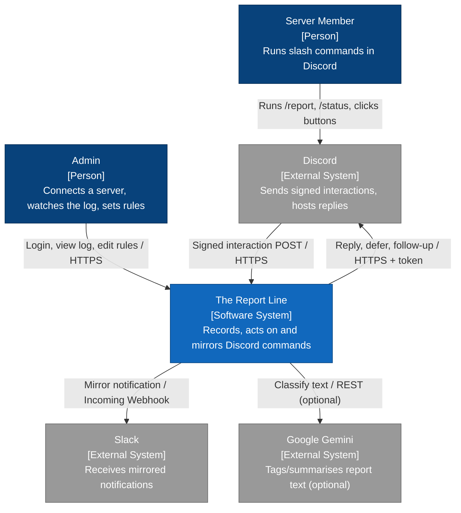

### 2.2 Containers (C4 L2)

*Answers: what are the runnable units and how do they communicate?*

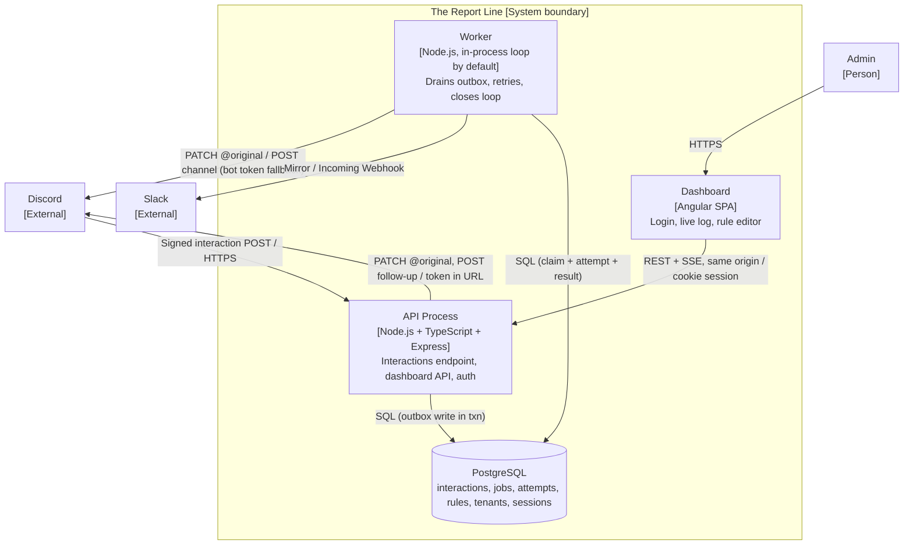

| Container | Responsibility | Tech | Owns data | Scales by |
|---|---|---|---|---|
| Dashboard | Admin UI: auth, log, rules | Angular SPA (static build, served by the API process from the same origin) | none (calls API) | with the API process |
| API process | Verify + route interactions; dashboard API; auth; outbox write | Node + TS + Express | writes all tables | add replicas (stateless) |
| Worker | Drain outbox, retry, follow-up, mirror | Node + TS | updates jobs/attempts | add replicas (SKIP LOCKED) |
| PostgreSQL | System of record + outbox + dedupe | Postgres 15+ | all | vertical (ample) |

### 2.3 Component view (inside the API process)

*Answers: what are the major parts of the request path and how do they depend on each other?*

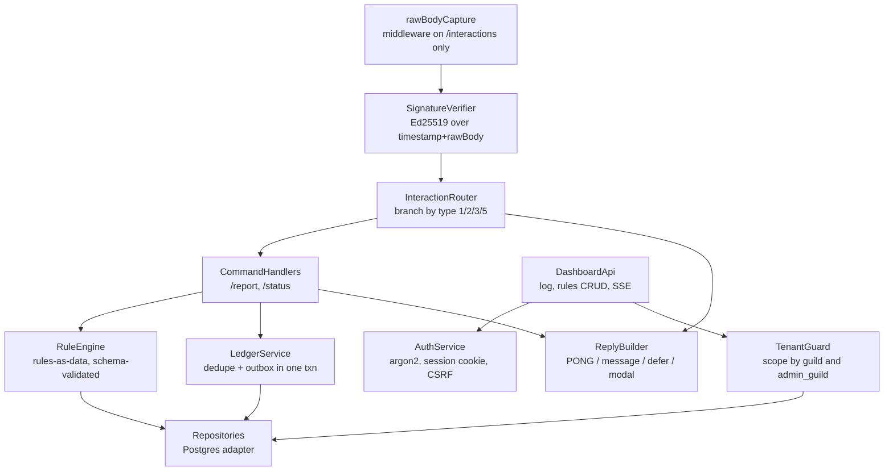

Dependency rule: arrows point from delivery/I/O toward the domain. `SignatureVerifier`, `InteractionRouter`, `RuleEngine` and `ReplyBuilder` are pure (no DB, no network) and are where the hard unit tests live. `Repositories`, Discord/Slack/Gemini clients are adapters behind interfaces.

### 2.4 Data flow with trust boundaries (DFD)

*Answers: how does data move and where are the trust boundaries? Flows are numbered for the threat model.*

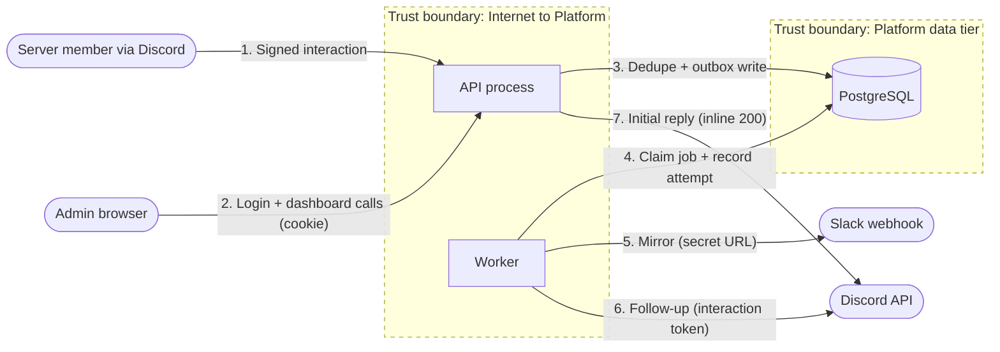

---

## 3. The three credentials (get these right or nothing works)

Verified against `docs.discord.com`. The reference HTML's intuition was correct; these are the precise roles.

| Credential | Direction | Used for | Secret? | Where it lives |
|---|---|---|---|---|
| Application ID | names the app | install URL, command registration, follow-up URLs | No | env (non-secret) |
| **Public key** | Discord → you | verify every inbound signature | No, but per-environment config | env |
| **Bot token** | you → Discord | post to a channel (mirror fallback), register commands | **Yes** | env only |
| Client secret | you → Discord OAuth | "Login with Discord" code exchange | Yes (unused: we use password auth) | not used in v1 |
| **Interaction token** | Discord → you, per interaction | edit/follow-up that one interaction for 15 min | **Yes, capability** | DB column, never logged |

Key distinction to be able to explain: the **public key only verifies**, so leaking it forges nothing and it needs no rotation (it is config, committed-safe). The **bot token acts as the bot** (arbitrary channel posts), so it is a true secret. The **interaction token** is a 15-minute capability scoped to one interaction, which is why follow-ups need no bot token, and why it must never appear in a log line or URL you record.

---

## 4. Discord mechanics, verified

Every number and rule below is from the official docs. Citations at the end of this section.

**Signature verification (the price of admission).** Each interaction carries `X-Signature-Ed25519` (hex signature) and `X-Signature-Timestamp`. You must validate *every* request by checking the Ed25519 signature over the bytes `timestamp + rawBody`, using the application public key. If it fails, respond **401**. This must happen before parsing or any side effect. Discord runs **automated routine checks and deliberately sends invalid signatures**; fail them and Discord removes your interactions URL and emails you. So rejecting forged requests is a liveness requirement, not just hygiene.

Build notes: verify over the **raw bytes**, because any JSON re-serialisation changes the bytes and every signature then fails. Guard against malformed input: a hex string of the wrong length or non-hex characters must return `false`/401, not throw a 500 (`Buffer.from('zz','hex')` silently truncates rather than throwing, so validate hex and the exact lengths, 64 hex chars for the timestamp-independent signature is 128 chars / 64 bytes, public key 64 hex / 32 bytes, then try/catch). Library: the official docs use `tweetnacl`; the `discord-interactions` npm package wraps it and also exports the type/response enums, so use that (`verifyKey`, `InteractionType`, `InteractionResponseType`). `node:crypto` Ed25519 (`crypto.verify(null, msg, keyObject, sig)`) is a zero-dependency alternative.

**Ed25519 vs HMAC (be ready for this question).** Discord signs with a private key it never shares; you hold only the public key, which cannot forge. Contrast HMAC (Slack, GitHub, Stripe) where one shared secret both signs and verifies, so a leak forges and comparison needs a timing-safe compare. Ed25519 verification has only public inputs, so timing side-channels reveal nothing; no `timingSafeEqual` needed.

**The two clocks.** You must send an **initial response within 3 seconds** or the token is invalidated and the user sees "The application did not respond". The **interaction token is valid for 15 minutes** for edits and follow-ups.

**PING on registration.** When you save the endpoint URL, Discord POSTs a `type: 1` PING. Answer `200` with `{"type": 1}` and a valid `Content-Type`. Fail and the URL will not save.

**Interaction types** (inbound): 1 PING, 2 APPLICATION_COMMAND, 3 MESSAGE_COMPONENT, 4 APPLICATION_COMMAND_AUTOCOMPLETE, 5 MODAL_SUBMIT. We handle 1, 2, 3, 5.

**Response (callback) types** (outbound): 1 PONG, 4 CHANNEL_MESSAGE_WITH_SOURCE, 5 DEFERRED_CHANNEL_MESSAGE_WITH_SOURCE, 6 DEFERRED_UPDATE_MESSAGE, 7 UPDATE_MESSAGE, 8 autocomplete result, 9 MODAL, 10 (deprecated), 12 launch activity. Types **6 and 7 are valid only for component and modal-submit interactions**. Type **9 (modal) is NOT available for PING or MODAL_SUBMIT** interactions.

**Correction to the reference HTML on modals.** The reference stated "no modal after a defer" as if it were a documented rule and hedged that the docs "only say a modal is unavailable for PING and MODAL_SUBMIT". The verified position: a modal is a legitimate initial response to a **slash command (type 2)** or a **component (type 3)**. You cannot send a modal in response to a PING or a MODAL_SUBMIT (documented), and you cannot send a modal *after* you have already used your one initial-response slot (e.g. after deferring) because follow-ups are message create/edit only. So "can't modal after defer" is a consequence of the single-initial-response model, not a separate modal rule. Practical upshot for `/report`: if you need a modal, it must be the *immediate* response to the command; you cannot defer first and then decide to open a modal.

**How you actually reply.** Two ways, we use the first for the initial response: (a) respond to Discord's webhook POST **inline** with HTTP 200 and the interaction-response JSON (`{type, data}`); (b) POST to `/interactions/{id}/{token}/callback` (returns 204), in which case you must answer the original HTTP request with 202. Use (a).

**Follow-ups (after a defer), exact endpoints, token in the URL, no bot token:**
- Edit the initial (deferred) reply: `PATCH /webhooks/{application_id}/{interaction_token}/messages/@original`
- New follow-up message: `POST /webhooks/{application_id}/{interaction_token}`
- Edit/delete a follow-up: `.../messages/{message_id}`

The docs note that calling POST-follow-up immediately after a `DEFERRED_CHANNEL_MESSAGE_WITH_SOURCE` edits the original for backwards compatibility, and that this behaviour is **deprecated**: use `PATCH .../messages/@original` to fill in a deferred reply. Follow-up messages themselves are not deprecated; only the edit-the-original side effect is. There is a second reason that matters more here: the worker retries. A retried `PATCH @original` writes the same message again (idempotent). A retried POST would edit the original the first time and create an extra message the second time, which is a duplicate visible to the user.

**Ephemeral flag** = `1 << 6` = `64`. On a deferred reply (`type 5`) it is the only flag you may set, so decide visibility at defer time; it cannot be changed later.

**After 15 minutes** the interaction token is dead and all follow-up calls fail. The only remaining route is a normal channel message using the **bot token** (requires the `bot` scope and Send Messages), which loses ephemerality. This is our fallback, not our default.

**Command registration.** Guild commands: `PUT /applications/{app_id}/guilds/{guild_id}/commands` (bulk overwrite) are available **instantly**, recommended for development/demo. Global commands: `PUT /applications/{app_id}/commands` are available on every guild that adds the app but **propagate more slowly** (the current docs do not commit to a number; historically up to ~1 hour, so do not promise instant). Auth with the bot token. `PUT` overwrites all commands in that scope. Rate limit: **200 command creates per day per guild**. Names: lowercase, 1 to 32 chars (regex enforced). The `applications.commands` scope is included automatically with the `bot` scope.

**Install URL / scopes.** OAuth2 authorize URL with scope `bot` (which carries `applications.commands`) and a least-privilege permission bitfield: **View Channel + Send Messages**. We need the bot user because we post to channels (mirror and the >15-min fallback).

**Sources:** [Receiving and Responding to Interactions](https://docs.discord.com/developers/interactions/receiving-and-responding), [Interactions Overview (security + PING)](https://docs.discord.com/developers/interactions/overview), [Application Commands](https://docs.discord.com/developers/interactions/application-commands).

---

## 5. Commands and interaction contracts

### 5.1 `/status` (fast path, demonstrates type 4)

No options. Reads a cheap, indexed count for the current guild ("N reports today, M jobs retrying, worker last beat 4 s ago") and replies **inline type 4**, optionally ephemeral. This is the "quick answer, no defer" demonstrator. A count query is well under 3 s; if it ever were not, defer it.

### 5.2 `/report` (slow path, demonstrates modal + defer + async + follow-up)

Registered with an **optional** STRING option `text` (`min_length` 1, `max_length` 1000):
- **If `text` is provided**: respond **type 5 (defer)** immediately, write the ledger + outbox job in one transaction, worker processes it, then `PATCH @original` with the result.
- **If `text` is absent**: respond **type 9 (modal)** immediately (custom_id `report_modal`, one paragraph text input `report_text`). The user submits → a **new** MODAL_SUBMIT (type 5) interaction arrives with its own id, token and fresh 3 s → defer there → write ledger + outbox → worker → `PATCH @original`.

This single command exercises both the option path and the modal path and makes the "modal must be the immediate response" rule concrete.

### 5.3 Button follow-up (stretch, demonstrates type 3 + type 7)

The processed `/report` reply (or a follow-up) carries an action row with buttons, e.g. **Acknowledge** and **Escalate**. `custom_id` encodes intent and the report reference, for example `rpt:ack:{interaction_id}`. The click is a **new** MESSAGE_COMPONENT (type 3) interaction: verify (same signature path), dedupe on its own id, authorise the action server-side (never trust `custom_id`), respond **type 7 (update message)** to reflect the new state, and record the component interaction and the action. A slow button action would defer with **type 6** then edit later.

### 5.4 Response decision table

| Inbound | Our response | User sees |
|---|---|---|
| PING (1) | PONG (1) | nothing |
| `/status` (2) | type 4 message | immediate reply |
| `/report` (2) with text | type 5 defer → PATCH @original | spinner then result |
| `/report` (2) no text | type 9 modal | popup form |
| modal submit (5) | type 5 defer → PATCH @original | spinner then result |
| button (3) quick | type 7 update message | message changes |
| button (3) slow | type 6 defer update → edit later | no spinner, then change |

Every deferred row above assumes the follow-up lands inside the 15-minute token window. If the worker finishes after `token_expires_at` has passed, the `PATCH @original` rows fall back to a channel post via the **bot token** (which loses ephemerality); see §10.2 and the response lifecycle in §11.2. Duplicate delivery of any row is absorbed by the dedupe row (§10.3), so the effect is exactly-once regardless of how many times Discord delivers.

### 5.5 Step 5 decisions (rev 7)

**Verified component numbers** (read on 2026-10-12, not coded from memory):

| Thing | Value | Source |
|---|---|---|
| Component types | Action Row 1, Button 2, Text Input 4, Label 18 (String Select 3, others unused) | [components/reference](https://docs.discord.com/developers/components/reference) |
| Button styles | Primary 1, Secondary 2, Success 3, Danger 4 (Link 5, Premium 6 unused) | same |
| Text input styles | Short 1, Paragraph 2 | same |
| `custom_id` | 1 to 100 characters, unique per component within a message | same |
| Label | `{type:18, label (max 45), description? (max 100), component}`: ONE child under singular `component` | same |
| Callback types | 6 DEFERRED_UPDATE_MESSAGE, 7 UPDATE_MESSAGE, 9 MODAL (not for PING or MODAL_SUBMIT) | [receiving-and-responding](https://docs.discord.com/developers/interactions/receiving-and-responding) |
| Modal | `{custom_id (1-100), title (max 45), components (1-5)}` | same |
| MODAL_SUBMIT, Label layout | `data.components[]: {type:18, component:{type:4, custom_id, value}}` | components/reference |
| MODAL_SUBMIT, legacy layout | `data.components[]: {type:1, components:[{type:4, custom_id, value}]}` (plural; Action Row text inputs in modals are deprecated) | same, structure only; the docs show no legacy submit example, so the router accepts both and tests cover both |

**Modal path decisions.**
- *Modal-open is not recorded.* `/report` with no `text` option answers type 9 and writes nothing: no effect has happened, and an action-less row would clutter the log. This matches Step 3, where a `/report` that did nothing (empty text) is not recorded either. A disabled `/report` never opens the modal; it gets the disabled notice, recorded like any disabled command.
- *Present-but-blank option* (`text: "   "`) is an error notice, not a modal: the option was supplied, so the user chose the text path.
- *Submit validation.* `custom_id` must equal `report_modal` (else ephemeral "I don't recognise that form", no row). The text is the `report_text` field, trimmed, 1 to 1000 characters counted as code points (same function as the option). Missing, blank or over-length: ephemeral type 4 notice, **no interaction row and no job**, because nothing was done and Discord already enforced the limits in its client. Cost, accepted: a rejected submit loses what the user typed (a modal cannot answer a MODAL_SUBMIT).
- *The rule is evaluated again at submit*: disabled gives the disabled notice (recorded as `answered` / `disabled`, no job); the type 5 `ephemeral` flag, the only flag set, comes from the rule at submit time.
- *Row shape.* The MODAL_SUBMIT row has `type = 5`, `command_name = 'report'` (so the log labels it like the text path), `custom_id = 'report_modal'` (our constant) and `options = NULL`. The text lives only in `job.payload`.

**Buttons on the reply.**
- The `PATCH @original` body carries one action row: Acknowledge (style 3) and Escalate (style 1), `custom_id` `rpt:ack:{id}` and `rpt:esc:{id}`, built and parsed only in `reportButtons.ts`. `{id}` is the report's interaction id (a snowflake, 20 characters at most), so a `custom_id` is at most 28 characters, never the token, never report text.
- The body depends only on the rule snapshot, the mirror outcome and the report id, so every retry of the PATCH sends the same bytes and stays idempotent.
- *The channel fallback carries no buttons.* It is a public post made when the reply is impossible. Buttons on it would let anyone in the channel act on a report that may have been private, and the report's own text is never in it when the rule was ephemeral. The fallback shows "<@user>, your report was logged (ref …)"; the reference is the interaction id. A report that ended in a fallback therefore cannot be acknowledged or escalated from Discord; the log shows it.
- Because the default rule is ephemeral, the default reply (and so its buttons) is visible to the reporter only. Acknowledge and Escalate are then used by the person who filed the report. Make `report.ephemeral` false to let a team act on reports. See the risk note in §5.5 "Who may click".

**Button clicks (type 3).** Handled inline, database-only, answered with type 7. The slow path (type 6 plus a `component` job) is not built in v1.
- *Order:* verify, replay check, parse, then `parseReportButton` (exact prefix, exact action, snowflake id; the router already bounds `custom_id` to 100 characters). Anything else is an ephemeral "I don't recognise that button", no write. Then the `/report` rule is resolved (see disabled, below), then one transaction in `PgReportActionStore`.
- *Authorisation, server-side.* `guild_id` is the signed payload's; the `custom_id` supplies only a report id. The report must exist **in that guild**, be an action of type `report`, and belong to a command or modal-submit interaction. Missing, another server's, or "not a report" all return the same ephemeral "I can't find that report on this server", which is also what the dashboard-style 404 rule means here.
- *Who may click: any member of that server* (the spec was silent). We do not check Discord permissions. **Risk, flagged:** if the rule is public (`ephemeral: false`), any member who can see the reply can acknowledge or escalate someone else's report. With the default ephemeral rule the reply is visible to the reporter only, so only they can click. A `MANAGE_GUILD` or role check from `member.permissions` would be the next step; it is not built.
- *States* are derived from ACTION rows, not stored: `reported` → `acknowledged` or `escalated`; `acknowledged` → `escalated`; `escalated` is final; nothing goes back. Acknowledged means "seen", so escalating afterwards is allowed.
- *Enforcement is in the database.* The transaction takes `SELECT … FOR UPDATE` on the report's own ACTION row (clicks on one report take turns), inserts the click's INTERACTION `ON CONFLICT (id) DO NOTHING RETURNING id` (the dedupe), then inserts the click's ACTION `… WHERE NOT EXISTS (blocking row for this report)`. A unique index `(report_id, type)` is the backstop. A click the state no longer allows rolls back the interaction insert, so **a refused click is not recorded**; it gets an ephemeral "This report was already acknowledged/escalated by <@user>". A redelivered, already-applied click is a duplicate and gets the same type 7 again.
- *Why a migration* (004, `action.report_id`): the click's ACTION had no link to its report except text inside `interaction.custom_id`, which cannot carry a foreign key, a unique constraint or an index. `report_id` is set for click rows only (a CHECK says so) and carries the unique index above. No existing row changes.
- *What is recorded:* INTERACTION `type 3`, `command_name NULL`, `custom_id` = the button's id (it holds only the report id), `status answered`, plus ACTION `acknowledged` or `escalated`. No job.
- *The type 7 body* is rebuilt from the database each time: the rule's reply text snapshotted on the report's job, the mirror warning if it failed, "✅ Acknowledged by <@user>" and "🚨 Escalated by <@user>", and only the buttons still allowed (none after escalation, sent as `components: []`). It goes through `plainBody` (2000-character cut, `allowed_mentions: {parse: []}`: the mentions render and ping nobody) and never contains the report text or the token. Flags cannot change on type 7, so the message keeps its original visibility.
- *What Escalate does and does not do in v1:* it records the escalation and shows it on the message. It does **not** call Slack or Discord, post to a channel, mention anyone, or create a job. (§5.3 does not ask for more.)
- *Disabled:* a turned-off `/report` also turns off its buttons. The click gets the disabled notice and nothing is written, so "off" means off on every path.

**Dashboard visibility.** The log and detail endpoints needed no query change: `command_name` was already nullable end to end (LEFT JOIN, `command: string | null` in the shared schema). A click (type 3, `command: null`, action `acknowledged` / `escalated`) is labelled "Button: Acknowledge" / "Button: Escalate"; a form submit is `/report` like the text path. `custom_id` is not in any dashboard response: the row mapper names every field and `custom_id` is not one, so even though a button's id holds only a report id it is not exposed. All reads stay behind `admin_guild`; another admin gets 404. The "saved rules are not applied yet" notice on the rules page is removed, because it is now false.

- *Known limitation, accepted:* the worker's `PATCH @original` always renders the buttons of the `reported` state, so that every retry sends the same bytes. If a PATCH reaches Discord but its response is lost and the user clicks before the retry, the retry shows both buttons again and drops the "Acknowledged by" line. The database stays right, and the next click on a stale button gets the "already acknowledged" notice. Reading the live state into the PATCH would remove this at the cost of a body that depends on the database; not done in v1.
- *Request time budget:* `/status` is the longest path (rule read, record, counts). `RULE_TIMEOUT_MS` (400) + `RECORD_TIMEOUT_MS` (1000) + `STATUS_TIMEOUT_MS` (1200) must be at most 2800, and config validation refuses a larger sum.

**Rules at runtime.** After Step 4 the controller still used defaults. Now `app/ruleResolution.ts: resolveAction` is the only place a stored rule becomes an `Action`: it reads `command_rule` for (signed guild id, command) with a 500 ms deadline, runs `validateRule` (an invalid row logs `rule.invalid_stored` with field paths only), and calls `evaluate`, which falls back to `DEFAULT_RULES`. If the rule cannot be read at all the user gets the ephemeral "not logged" notice rather than a guess about whether the command is switched off.
- *Snapshot:* audited, no code change needed. The worker never reads `command_rule`. `ephemeral`, `replyMessage`, `mirror` and `tag` are copied into `job.payload` at enqueue, and `mirror_status` is set on the ACTION row in the same transaction, so an admin editing the rule between the defer and the worker pass cannot change visibility, wording, mirroring or what the fallback post reveals. Tests edit the row after the defer to prove it.
- *Logging a bad stored row:* `rule.invalid_stored` carries field paths from `loggableFields`, which reports only the field names a rule defines. `validateRule` names an invented key because the editor shows it to the admin who typed it; in a stored row that name is unvetted data, so a log reports it as `(root)`.
- *Disabled* means off on every path: `/status`, `/report` with text, `/report` with no text (no modal), the modal submit, and the report buttons. Only a commandless interaction (an unreadable rule) is answered differently, with the "not logged" notice.

---

## 6. (merged into 2 and 5)

---

## 7. Module structure (LLD)

```
src/
  domain/                 # pure, no I/O, the hard unit tests live here
    signature.ts          # verifySignature(timestamp, rawBody, publicKey): boolean
    router.ts             # classify(interaction): RouteDecision
    # ReplyBuilder (§2.3), split by reason-to-change, not by kind of declaration:
    discordProtocol.ts    # Discord wire constants, limits, JSON types (changes when Discord does)
    discordResponses.ts   # pong/message/defer/deferUpdate/updateMessage; plainBody = the ONE place
                          #   allowed_mentions and the 2000-char cut are applied
    discordText.ts        # truncate (code-point safe)
    messages.ts           # every user-visible string
    status.ts             # StatusCounts, statusText (/status)
    reportModal.ts        # /report modal (type 9)
    reportButtons.ts      # button custom_id encode + parse (one contract, one file)
    reportReplies.ts      # PATCH @original result body, channel fallback body
    rules.ts              # RuleEngine: evaluate(command, ctx, rule): Action ; validateRule(json)
    retry.ts              # classifyFailure(failure): Outcome ; nextBackoffMs(...) ; retryDelayMs(...)  (§8.1)
    types.ts              # Actor, Tenant, MessageRef, Action (backend-only); re-exports the enums from @report-line/shared
  app/                    # orchestration, depends on domain + ports
    interactions.ts       # the endpoint handler: verify → route → dedupe+outbox → reply
    ledger.ts             # LedgerService: dedupe + outbox in one txn
    worker.ts             # claim loop, process, record attempt, schedule retry / fallback
    dashboard.ts          # log queries, rules CRUD, SSE feed (all tenant-scoped)
    auth.ts               # login/logout, session, CSRF
  ports/                  # interfaces (the seams)
    repositories.ts       # InteractionRepo, JobRepo, AttemptRepo, RuleRepo, GuildRepo, SessionRepo
    discord.ts            # DiscordClient: editOriginal, followup, postChannelMessage, registerCommands
    slack.ts              # SlackMirror: send(url, payload)
    llm.ts                # Tagger: tag(text): Promise<Tag>
    clock.ts, random.ts   # injected for deterministic tests
  adapters/               # concrete implementations of ports
    pg/*.ts               # Postgres repositories
    discordHttp.ts, slackHttp.ts, geminiHttp.ts
  http/
    server.ts             # Express wiring; raw-body on /interactions ONLY; serves the built Angular bundle + SPA fallback (same origin as /api)
    middleware.ts         # rawBodyCapture, structured logger w/ redaction, error handler
  config.ts               # env parsing + validation (fail fast if a secret is missing)
  index.ts                # starts HTTP server + in-process worker (unless WORKER_MODE=standalone)
scripts/
  register-commands.ts    # PUT guild/global commands
  seed-admin.ts           # create the throwaway admin
```

Dependency rule, enforced by lint (`no-restricted-imports` per folder; eslint-plugin-boundaries optional): `domain` imports only `domain`, `@report-line/shared`, `zod`, and `node:crypto` (pure computation, `signature.ts` only, because §8.1 requires a synchronous verify and `discord-interactions` `verifyKey` is async). This is a strict allow-list in lint: any other bare import in `domain/` is an error. `app` imports `domain`, `ports` and `@report-line/shared`. `adapters` implement `ports`. `http` wires everything. Nothing in `domain`/`app` imports Express, `pg`, or `fetch` directly.

**Package graph (rev 3, proposal 0003).** Dependencies point one way only:

```
apps/web  ──►  packages/shared  ◄──  apps/api
                     │
                     ▼
                    zod            (nothing else)
```

`packages/shared` (`@report-line/shared`) is a leaf: zod schemas, `as const` enum tuples, `DEFAULT_RULES`, API error codes. It never imports `apps/*`, `node:*` or anything that does I/O, so the Angular build can never pull in backend code such as `domain/signature.ts` (`node:crypto`). Lint enforces this inside `packages/shared` (ban `apps/*`, `node:*`, `pg`, `express`). Rejected: domain owning the enums and shared re-exporting them, because a shared library that depends on an app makes the frontend build against the backend package and creates a cycle with the schemas flowing the other way. Duplicating the lists in both places was rejected as two sources of truth for a contract the frontend binds to.

### 7.1 Runtime model, concurrency and tunables

**Concurrency model.** One Node process, one event loop. The worker is an async polling loop, not `worker_threads`: every job's work is I/O-bound (HTTP to Slack, Discord and Gemini, SQL to Postgres), so the event loop runs a batch concurrently without threads. The claim query pulls up to `CLAIM_BATCH` jobs and processes them under a bounded `Promise.all`; CPU cost per job is negligible, so the loop is not a bottleneck at this load (§1.4). If genuinely CPU-bound work were ever added (large-payload parsing, crypto beyond the signature verify), it would move to `worker_threads`; nothing today qualifies. Two API replicas can run for HA because the claim uses `FOR UPDATE SKIP LOCKED`, so their worker loops never claim the same job.

**Tunables.** These are our defaults, centralised in `config.ts`. None is a Discord-imposed number except the token lifetime, which is noted.

| Name | Default | Why |
|---|---|---|
| `CLAIM_BATCH` (claim `LIMIT`) | 5 | Drains a 10–30 burst in a few loops; bounds concurrent outbound calls |
| `POLL_INTERVAL_MS` | 1000 | Idle poll cadence; trivial DB load, far inside the 15-min window |
| `LEASE_MS` (claim lease) | 60000 | Must exceed the longest single job pass; an expired lease returns the job to pending (crash recovery) |
| `CALL_TIMEOUT_MS` (AbortSignal) | 5000 | Per outbound call; a call without one can hang a job forever |
| `MAX_ATTEMPTS` | 8 | Then the job is marked dead and kept visible |
| `BACKOFF_BASE_MS` | 500 | Full-jitter base: `rnd() * min(BACKOFF_MAX_MS, BASE * 2**attempt)` |
| `BACKOFF_MAX_MS` | 60000 | Caps backoff so a recovered dependency is retried within a minute |
| `REPLAY_WINDOW_MS` | 300000 | Reject older `X-Signature-Timestamp` (§13, our decision) |
| Interaction token life | 900000 | **Discord's**, not ours: the 15-min follow-up window |

The one invariant between these: `LEASE_MS` must be greater than `CALL_TIMEOUT_MS` (in practice, greater than the worst-case single pass), or a slow-but-alive job gets re-claimed while still running. If you raise the per-call timeouts, raise the lease too.

---

## 8. Component contracts (key interfaces)

### 8.1 Key interfaces and signatures

```typescript
// domain/signature.ts  — pure, the forged-request test target
export function verifySignature(
  timestamp: string | undefined,
  rawBody: Buffer | undefined,
  signatureHex: string | undefined,
  publicKeyHex: string,
): boolean;
// Returns false (never throws) on: missing headers, non-hex, wrong length, bad signature.
// Caller maps false → HTTP 401. Replay check is separate (see below).

// domain/router.ts
export type RouteDecision =
  | { kind: 'ping' }
  | { kind: 'command'; name: string; options: Record<string, unknown>; actor: Actor; tenant: Tenant }
  | { kind: 'component'; customId: string; actor: Actor; tenant: Tenant; message: MessageRef }
  | { kind: 'modalSubmit'; customId: string; fields: Record<string, string>; actor: Actor; tenant: Tenant }
  | { kind: 'unsupported' };
export function classify(interaction: RawInteraction): RouteDecision;
// Reads actor from member.user.id (guild) or user.id (DM). Rejects DMs for guild-scoped commands.

// app/ledger.ts  — dedupe + outbox, the exactly-once test target
export interface LedgerService {
  // ONE transaction: INSERT interaction ON CONFLICT(id) DO NOTHING RETURNING id,
  // and if a row was inserted, INSERT the job. Returns 'won' | 'duplicate'.
  recordAndEnqueue(input: RecordInput): Promise<'won' | 'duplicate'>;
}

// domain/retry.ts
export type Outcome = 'retryable' | 'fatal';
export interface CallFailure {
  status?: number;                      // HTTP status, when there was a response
  kind?: 'timeout' | 'network';         // no response
  retryAfterMs?: number;                // parsed by the adapter from Retry-After / Discord's retry_after (seconds → ms)
}
export function classifyFailure(e: CallFailure): Outcome;
// retryable: timeout, network, 5xx, 429. fatal: every other 4xx, INCLUDING 401/404 from the
// Discord follow-up, 408 and 425. classifyFailure does not know the call target or token age,
// and must not: what to do AFTER a fatal follow-up (channel fallback) is the worker's job (§11.3).
export function nextBackoffMs(attempt: number, baseMs: number, maxMs: number, rnd: () => number): number;
// full jitter: rnd() * min(maxMs, baseMs * 2 ** attempt)
export function retryDelayMs(e: CallFailure, attempt: number, baseMs: number, maxMs: number, rnd: () => number): number;
// retryAfterMs present → max(retryAfterMs, 0), NOT capped at maxMs: retrying before the server's
// Retry-After earns another 429, and on Discord repeated 429s count toward the invalid-request
// limit (Cloudflare IP ban). Otherwise → nextBackoffMs(...). A Retry-After that runs past
// token_expires_at is fine: the next pass sees the expired token and takes the fallback.

// ports/discord.ts
export interface DiscordClient {
  editOriginal(appId: string, token: string, body: MessageBody): Promise<void>;   // PATCH @original
  followup(appId: string, token: string, body: MessageBody): Promise<void>;        // POST
  postChannelMessage(channelId: string, body: MessageBody): Promise<void>;         // bot token fallback
  registerGuildCommands(appId: string, guildId: string, cmds: Command[]): Promise<void>;
}
```

Every adapter method that calls the network takes an **AbortSignal timeout** (`AbortSignal.timeout(ms)`) and surfaces whether the failure was a timeout, a network error, or an HTTP status, so `classifyFailure` can decide. A call without a timeout can hang and hold a job forever; that is a defect.

### 8.2 Class and OOP view

The design is OOP where an object carries state or collaborators, and plain functions where the logic is a pure transformation. The split is deliberate; it is what keeps SOLID load-bearing here rather than decorative.

**Pure functions, no class.** `verifySignature`, `classify` (router), `classifyFailure` and `nextBackoffMs` (retry), the reply builders and the rule evaluator are stateless: input in, value out, no fields, no collaborators. They are the reliability-critical, heavily unit-tested code (§16, steps 1–3). A class would add a constructor and an instance to mock for no gain; you test these by calling them. The boxes in the component view (§2.3) named `SignatureVerifier`, `InteractionRouter`, `ReplyBuilder` and the core of `RuleEngine` are *logical* components implemented as these functions, not classes.

**Classes, state plus injected collaborators.** Everything holding a dependency or state is a class with constructor injection, typed against the port interface and never the concrete: the `InteractionController` (endpoint orchestrator, `app/interactions.ts`, dispatching to per-command handlers as a Strategy), the `Worker`, `DashboardApi`, `AuthService`, `TenantGuard`, and every adapter (`PgLedger`, `PgJobRepo`, `DiscordHttpClient`, `SlackHttpClient`, `GeminiTagger`).

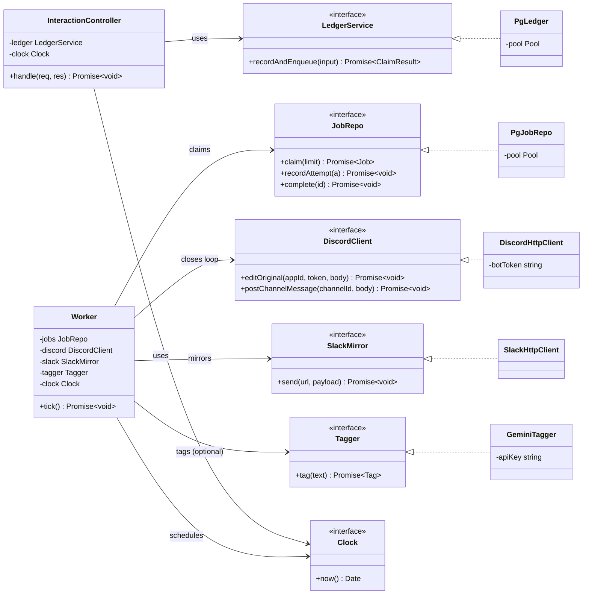

*Answers: which parts are classes, what they depend on, and in which direction.*

Where each SOLID principle actually lives:
- **DIP:** `InteractionController` and `Worker` depend only on port interfaces; the adapters realise them. Every arrow points from the orchestrators toward the abstractions, and the abstractions are owned by the policy side (`ports/`), not the adapters. That ownership is the point, not the mere presence of interfaces.
- **ISP:** ports are narrow and role-shaped (`SlackMirror.send`, `Tagger.tag`, repos split per aggregate) rather than one fat service, so the worker depends on `JobRepo` and not on session or rule methods it never calls.
- **SRP:** one change-driver per unit. `PgLedger` changes if the outbox write changes; `DiscordHttpClient` changes if Discord's follow-up API changes; neither drags the other.
- **OCP:** commands and rules are Strategy plus rules-as-data (§12). A new command or rule is a new handler or row, not an edit to the dispatcher.
- **LSP:** the in-memory fakes used in the unit tests substitute for the pg and HTTP adapters without the orchestrators noticing. That substitution passing *is* the Liskov test in practice.

**Composition root.** No DI container. Dependencies are wired by hand in `http/server.ts` (request path) and `index.ts` (worker). That is the idiomatic Node approach at this size; a container (Nest, tsyringe) is ceremony no requirement here pays for.

**Deviations (per the one-line rule):**
- Pure domain logic is functions, not classes. *Instead:* module-level exported functions. *Why:* a class with no fields is ceremony, and these are the easiest units in the codebase to test.
- Each port has one production implementation. *Kept anyway because:* the second implementation is the in-memory fake the reliability tests need, so the seam earns its place. This is not an interface-with-one-impl smell.
- `PgLedger` does the interaction-plus-job write as one unit rather than composing two repositories inside a transaction. *Why:* that atomicity is the whole point of the outbox (ADR-0001); splitting it across two repos would invite a caller to break the transaction boundary.

### 8.3 Rules, actions and domain enums (contract shared with the dashboard)

Accepted from proposal 0002, option A, with one amendment: **the rule config is per command, not one shape for both.** The proposal's single shape forced `/status` to carry `replyMessage: ""`, which breaks its own 1–300 rule, and would make the editor show controls that do nothing. A discriminated schema keyed by `COMMAND_RULE.command_name` fixes both.

```typescript
// packages/shared/src/rules.ts (@report-line/shared) — zod, .strict(); the dashboard rule editor binds to these
export const StatusRuleConfig = z.object({
  version: z.literal(1),
  ephemeral: z.boolean(),
}).strict();

export const ReportRuleConfig = z.object({
  version: z.literal(1),
  ephemeral: z.boolean(),                       // fixed at defer time (§4: the only flag type 5 accepts)
  replyMessage: z.string().trim().min(1).max(300), // plain text, no placeholders in v1
  mirror: z.boolean(),                          // F-05 Slack notification
  tag: z.boolean(),                             // F-12; no effect unless LLM_ENABLED
}).strict();

export const RULE_SCHEMAS = { status: StatusRuleConfig, report: ReportRuleConfig } as const;
export type CommandName = keyof typeof RULE_SCHEMAS;   // 'status' | 'report'

export const DEFAULT_RULES = {
  status: { version: 1, ephemeral: true },
  report: { version: 1, ephemeral: true, replyMessage: 'Report logged. The team has been notified.', mirror: true, tag: false },
} as const;
```

`enabled` stays its own `COMMAND_RULE` column (it is a switch, not config, and the log query filters on it). No row for a command = enabled with the default config.

```typescript
// domain/rules.ts — pure
export type RuleValidation<C> = { ok: true; rule: C } | { ok: false; fields: string[] };
export function validateRule(command: string, json: unknown): RuleValidation<StatusRuleConfig | ReportRuleConfig>;
// Never throws. Unknown command → { ok:false, fields:['command'] }. Reports field PATHS, never values.
// Dashboard save: !ok → 400 VALIDATION_FAILED with the fields. Runtime: !ok → log a warning, use DEFAULT_RULES[command].

export interface RuleContext { enabled: boolean }        // from COMMAND_RULE.enabled; true when no row
export function evaluate(command: string, ctx: RuleContext, rule: unknown | null): Action;
// rule = the stored config JSON or null (no row). evaluate calls validateRule itself, so an invalid
// stored row can never crash a command. Order: unknown command → disabled → command action.

// domain/types.ts — backend-only types; the enum tuples below are DEFINED in @report-line/shared
// (packages/shared/src/enums.ts) and re-exported here (named re-exports from '@report-line/shared', no deep subpath imports)
export type Action =
  | { type: 'unknown_command' }                                   // ephemeral "I don't know that command."
  | { type: 'disabled' }                                          // ephemeral "This command is turned off on this server."
  | { type: 'status'; ephemeral: boolean }                        // type 4, inline
  | { type: 'report'; ephemeral: boolean; replyMessage: string; mirror: boolean; tag: boolean };
// 'report' does not decide modal vs defer: the handler does, from whether the `text` option is present (§5.2).
// The rule is evaluated again on the MODAL_SUBMIT, because that is where the defer and the job happen.
// Buttons (§5.3) are not rule-driven in v1.

export type Actor = { userId: string };
export type Tenant = { guildId: string; channelId: string };
export type MessageRef = { messageId: string };
// router: no guild_id (a DM) → { kind: 'unsupported' }; reply ephemeral "This bot only works in servers.", not stored
// (INTERACTION.guild_id is a NOT NULL FK). Modal submit fields are read from both Label (type 18 → text input
// type 4) and legacy Action Row (type 1) layouts; the modal we SEND uses Label + text input.

export const JobStatus        = ['pending', 'processing', 'done', 'dead'] as const;
export const JobKind          = ['report', 'component'] as const;
export const AttemptOutcome   = ['success', 'retryable', 'fatal'] as const;
export const AttemptTarget    = ['tag', 'mirror', 'followup', 'fallback'] as const;
export const InteractionStatus = ['answered', 'deferred', 'followed_up', 'fallback_posted', 'failed'] as const;
export const ActionType       = ['report', 'status', 'disabled', 'unknown_command', 'acknowledged', 'escalated'] as const;
export const MirrorStatus     = ['pending', 'sent', 'failed', 'skipped'] as const;
export const TagFallback      = 'untagged';
```

Every enum is an `as const` tuple defined once in `packages/shared/src/enums.ts` (re-exported by `domain/types.ts`) and a `CHECK (col IN (...))` constraint in the migration. One list, two enforcements; a value the code invents fails at the DB.

**One job per interaction** (§9's unique `job.interaction_id` stands; the `resilience` skill's "several jobs per interaction" is withdrawn). The job runs its steps in order, each with a durable marker so a retry skips what already happened. See §11.3.

---

## 9. Data model

*Answers: what is persisted, who owns it, how dedupe and the outbox are enforced.*

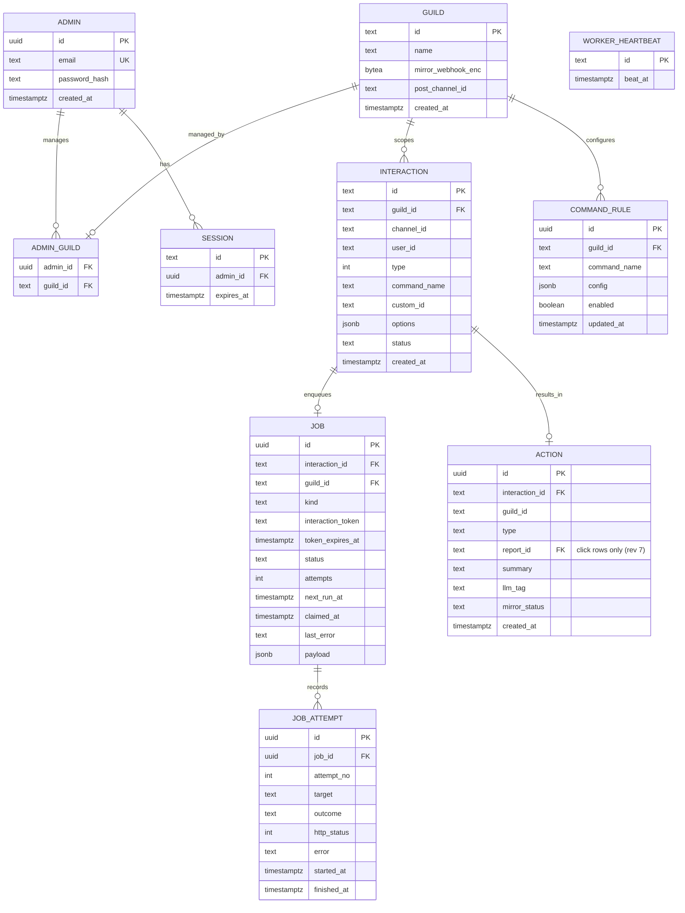

**The two load-bearing constraints:**
- `INTERACTION.id` is the Discord interaction id and the **primary key**: this is the dedupe key. The dedupe is one statement: `INSERT INTO interaction (...) VALUES (...) ON CONFLICT (id) DO NOTHING RETURNING id;` A returned row means you won; no row means a duplicate. (Mongo equivalent: unique index + error 11000.) Never SELECT-then-INSERT: two concurrent deliveries both see "absent" and both act. Only the database enforces uniqueness under concurrency.
- `JOB.interaction_id` is **unique**: one job per interaction. The job is inserted in the **same transaction** as the interaction row (the outbox), so the intent to do slow work is durable before you ACK Discord.

**Enum columns (CHECK constraints, values from §8.3):** `INTERACTION.status` ∈ InteractionStatus; `JOB.status` ∈ JobStatus; `JOB.kind` ∈ JobKind; `JOB_ATTEMPT.outcome` ∈ AttemptOutcome; `JOB_ATTEMPT.target` ∈ AttemptTarget (which call the attempt was, so the dashboard can say "Slack 503" vs "Discord 401"); `ACTION.type` ∈ ActionType; `ACTION.mirror_status` ∈ MirrorStatus; `COMMAND_RULE.command_name` ∈ `('status','report')`. PINGs, rejected requests, duplicates and DMs are never stored, so they have no status value.

**Step markers for the one-job-per-interaction worker:** the `ACTION` row is inserted in the **same outbox transaction** as the interaction and job (`mirror_status = 'pending'` if the rule says mirror, else `'skipped'`; `llm_tag` NULL). The worker only ever UPDATEs it. `llm_tag IS NOT NULL` = tagging done; `mirror_status = 'sent'` = the "mirrored" marker §14 requires. Each marker is committed immediately after its step succeeds, before the next outbound call.

**Rev 4 data-model decisions (made before Step 2 so the ledger isn't blocked):**
- **Unknown guilds.** `INTERACTION.guild_id` references `GUILD`, but a guild row exists before any admin connects it (F-02 is Step 4). The ledger transaction starts with `INSERT INTO guild (id) VALUES ($1) ON CONFLICT (id) DO NOTHING`. `GUILD.name`, `post_channel_id` and `mirror_webhook_enc` are nullable until an admin connects the server. This is safe for tenancy: dashboard access comes only from `ADMIN_GUILD`, which only the connect flow writes. Rejected: refusing commands from unconnected guilds, because it breaks `/status` in the test server before the dashboard exists, and the bot is already invited by then.
- **What gets recorded.** Every actionable, guild-scoped interaction gets an `INTERACTION` row and an `ACTION` row. Only slow paths (`/report` defer, slow buttons) also get a `JOB` row, so `recordAndEnqueue` takes an optional job. `/status`, `disabled` and `unknown_command` are recorded with `status = 'answered'` and `mirror_status = 'skipped'`. They show in the live log (F-06) and have no job. PINGs, rejected requests, duplicates and DMs are not recorded (§8.3).
- **Duplicates on the fast path.** A duplicate `/status` is not recorded again, but it still gets a normal reply, because a status read is safe to repeat.
- **"Today"** in `/status` means the current UTC day. The worker heartbeat stays `null` until Step 3 decides where it is stored.
- **Persistence stack.** `pg` with parameterised SQL. No ORM and no query builder: the load-bearing SQL (`ON CONFLICT … RETURNING`, `FOR UPDATE SKIP LOCKED`) is plain SQL, and an abstraction would hide exactly what a reviewer needs to see. Migrations are numbered plain `.sql` files applied in order by a small runner that records applied files in a `schema_migrations` table.
- **DB timeouts on the request path.** The ledger write must finish inside the 3 s window. Use pool `connectionTimeoutMillis` of 1000 and a `statement_timeout` of 1500 ms on the request path. When the database is unavailable, reply with ephemeral `MESSAGES.notRecorded` within 3 s (resilience skill), never a 500 and never a fake success.

**Rev 6 data-model decision (connect flow, F-02):** an admin connects a server by entering its id. Who may claim a server was not decided before, and "any admin may claim any server the bot is in" would let admin A take over a server admin B already runs. Decision: **first claim wins, one managing admin per server.**
- `ADMIN_GUILD` primary key is `guild_id` alone (migration 003; `admin_id` keeps an index). The database, not the code, enforces "at most one admin per server".
- `POST /api/guilds { guildId }` is one statement: `INSERT INTO admin_guild (guild_id, admin_id) SELECT id, $admin FROM guild WHERE id = $guild ON CONFLICT (guild_id) DO UPDATE SET admin_id = admin_guild.admin_id WHERE admin_guild.admin_id = EXCLUDED.admin_id RETURNING ...`. A free server is claimed; the same admin claiming again gets the row back (idempotent, 200); a server another admin manages returns no row. There is no SELECT-then-INSERT, so two admins racing for one server get exactly one winner.
- The server must already exist as a `GUILD` row (the bot has seen an interaction from it, §9 Rev 4). The connect call never creates a guild.
- **No enumeration beyond the necessary:** "no such server" and "managed by someone else" return the same 404 `NOT_FOUND` body. The only thing the answer reveals is that a server is claimable (200), which the caller then owns.
- **Residual weakness, accepted for the demo:** nothing proves the admin actually administers that Discord server. Anyone with a dashboard account who knows (or guesses) the id of an unclaimed server the bot is in can claim it first. With one seeded throwaway admin this is acceptable. Production would verify through Discord OAuth2 (`identify` + `guilds` scopes, `MANAGE_GUILD` / owner on the guild) before writing `ADMIN_GUILD`, and would let a verified owner reclaim a server. Not built.
- Disconnecting and transferring a server are out of scope; they would be explicit, audited operations.

**Rev 7 data-model decision (migration 004):** `ACTION.report_id` (nullable text, foreign key to `INTERACTION`) is set only on click rows (`acknowledged`, `escalated`; a CHECK enforces both directions), with a unique index `(report_id, type)` so a report is acknowledged at most once and escalated at most once. See §5.5.

**Indexes:** `JOB (status, next_run_at)` for the claim query; `INTERACTION (guild_id, created_at DESC)` for the log; `JOB_ATTEMPT (job_id, attempt_no)`; `SESSION (expires_at)` for cleanup; unique `COMMAND_RULE (guild_id, command_name)`.

**Token handling (claim-check):** `interaction_token` lives only in its own `JOB` column, is cleared when the job reaches `done`/`dead` or after `token_expires_at`, and is excluded from every log line, the `options`/audit JSON, and any index. It is a 15-minute capability.

**Secrets at rest:** `mirror_webhook_enc` is the Slack URL encrypted with AES-256-GCM using a key from env (`WEBHOOK_ENC_KEY`). It must be in the DB because each tenant configures its own via the dashboard. The bot token, public key, Gemini key and encryption key are env-only, never in the DB.

**Retention:** interaction ids kept well beyond the replay window (indefinitely for the demo). A periodic sweep clears expired tokens and prunes `done` jobs older than N days (optional for v1).

---

## 10. Sequence diagrams

### 10.1 Endpoint setup + PING, and forged-request rejection

*Answers: how the URL is accepted and how a bad signature is handled. Trigger: Discord validates the endpoint; later, anyone POSTs junk.*

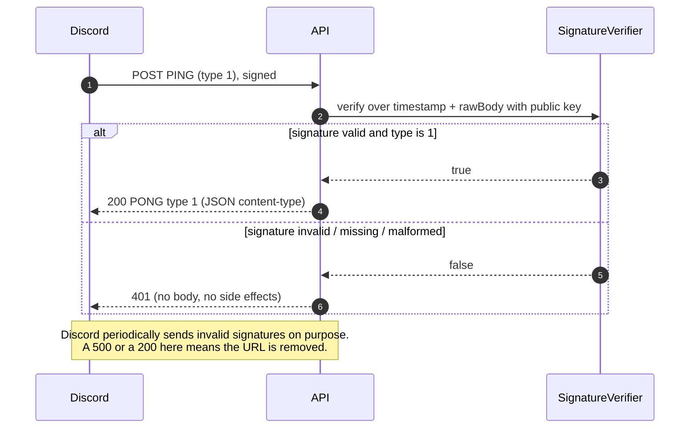

### 10.2 `/report` via modal, slow path, with failure branches

*Answers: the full happy path plus what happens when Slack is down and when the token expires. Trigger: user runs /report with no text.*

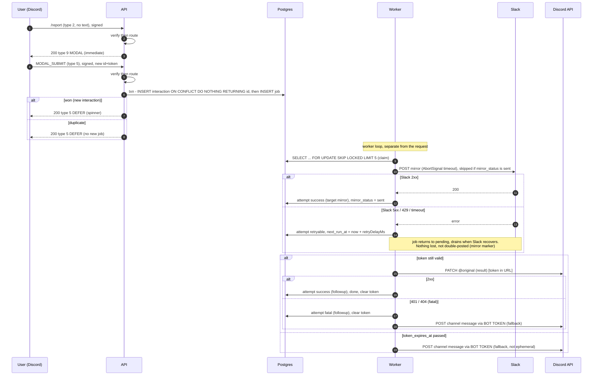

Rev 2 fixed an ordering defect here: the earlier diagram marked the job `done` and cleared the token **before** the `PATCH @original`, so the PATCH had no token and a failed PATCH could never be retried. The job is `done` only after the follow-up (or fallback) succeeds. Full step order in §11.3.

### 10.3 Concurrent duplicate delivery (exactly-once effect)

*Answers: what happens when the same interaction id is delivered twice at once. Trigger: Discord redelivery or a replayed request that passed signature.*

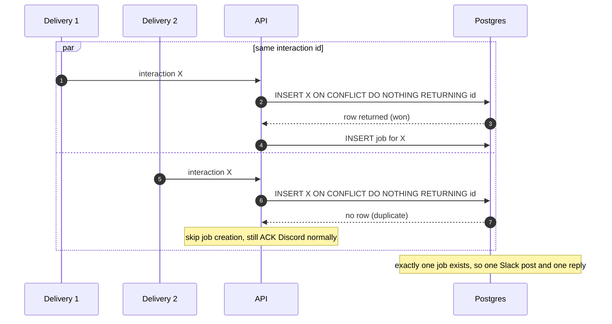

### 10.4 Dashboard IDOR attempt (tenant isolation)

*Answers: can admin A read admin B's guild by changing an id? Trigger: admin A requests guild B's log.*

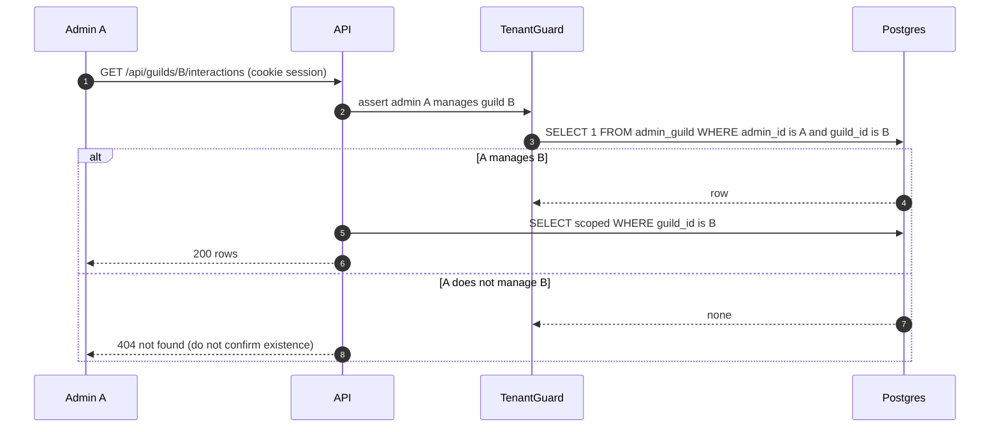

---

## 11. State machines

### 11.1 Job lifecycle (the heart of reliability)

*Answers: how a job moves through processing, retries, crash recovery and death.*

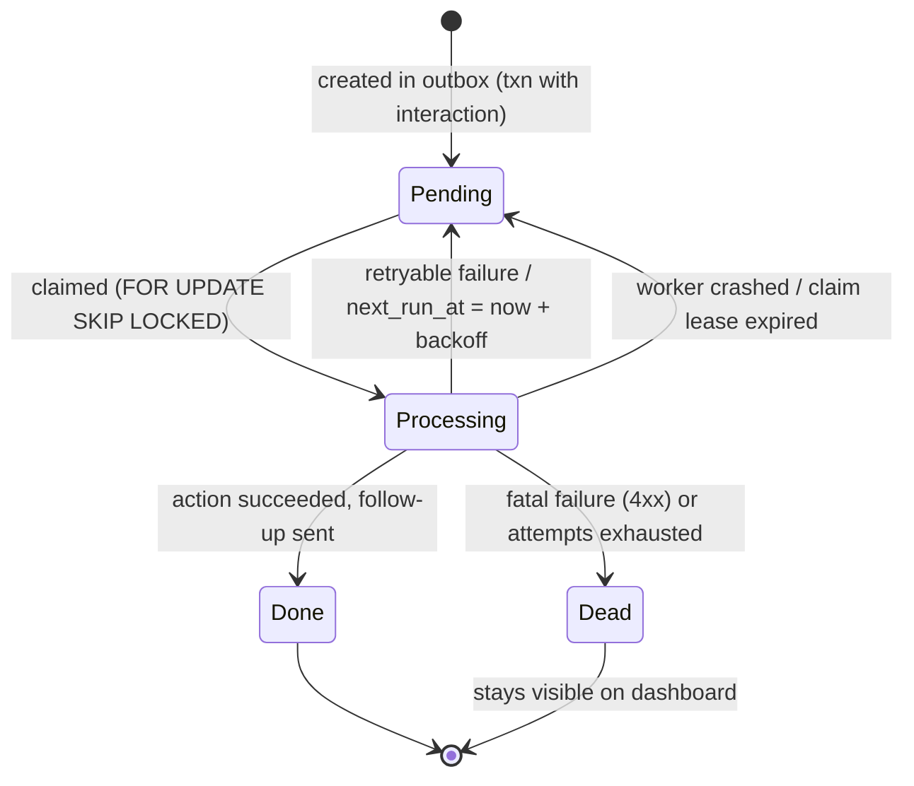

Transition notes: a claim sets `claimed_at` and bumps `attempts`; a lease is "claimed but `claimed_at` older than T", which a sweeper (or the claim query itself) returns to `Pending` so a crashed worker's job is picked up. `Dead` is terminal but **remains visible** with its full attempt history.

### 11.2 Interaction response lifecycle

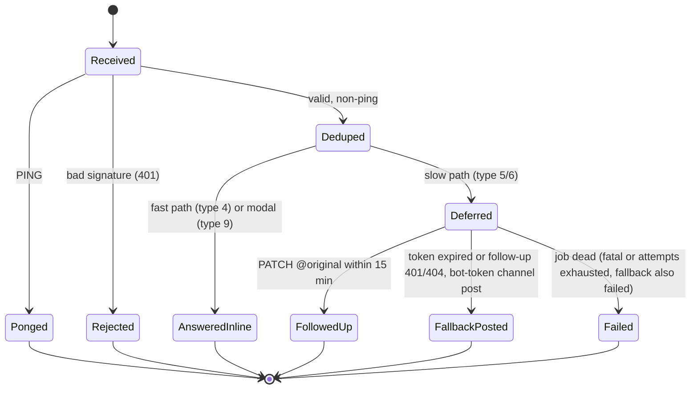

Stored `INTERACTION.status` maps from this: `AnsweredInline` → `answered`, `Deferred` → `deferred`, `FollowedUp` → `followed_up`, `FallbackPosted` → `fallback_posted`, `Failed` → `failed`. `Received`, `Rejected`, `Ponged` and `Deduped` are transient and never persisted.

### 11.3 Report job steps (one job, ordered, each step idempotent)

| # | Step | Skip if | On success | On failure |
|---|---|---|---|---|
| 1 | Tag (if rule `tag` and `LLM_ENABLED`) | `llm_tag IS NOT NULL` | write `llm_tag` | **one try per pass, never retried:** write `llm_tag = 'untagged'`, record attempt (target `tag`), continue. Tagging never blocks the mirror. |
| 2 | Mirror (if rule `mirror`) | `mirror_status IN ('sent','skipped','failed')` | `mirror_status = 'sent'`, commit now | retryable → job back to `pending` with `retryDelayMs`; fatal → `mirror_status = 'failed'` and `last_error` = reason, commit now, continue to step 3 so the user still gets an answer ("logged, notification failed"). Never called again |
| 3 | Follow-up `PATCH @original` | token is NULL or `token_expires_at` passed → go to 4 | clear token, interaction `followed_up`, then **finish** (below) | retryable → `pending` with `retryDelayMs`; **401/404 or any fatal → clear token, go to 4 now** |
| 4 | Fallback: bot-token post to `GUILD.post_channel_id` | n/a | interaction `fallback_posted`, then **finish** | retryable → `pending` (the next pass skips 1–3: mirror has a final status, token is NULL); fatal (e.g. 403 missing permission, no `post_channel_id`) → job `dead`, interaction `failed` |

**Finish (one rule for the job's end state):** job `dead` if `mirror_status = 'failed'`, otherwise job `done`. The **interaction** status says what the user saw (`followed_up` / `fallback_posted` / `failed`); the **job** status says whether every required step succeeded. So a failed mirror with a successful reply ends `job = dead, interaction = followed_up`: the user got an answer, and the broken webhook stays on the dashboard's dead list and in the dead-job alert, which is where an admin needs to see it. Tag failures never make a job dead (best-effort).

The fallback message is public, so it **never contains the report text** when the rule had `ephemeral: true`: it says "<@user>, your report was logged." plus the reference. Leaking a privately submitted report into a public channel would be worse than a missing reply.

Every pass that makes an outbound call writes one `job_attempt` row with its `target`. `MAX_ATTEMPTS` counts passes, not rows.

### 11.4 Why the follow-up 401/404 is fatal (proposal 0001, accepted)

The earlier §14 row said "if < 15 min, retry". Rejected: a 401/404 from the webhook route inside the window is deterministic (the 3 s ACK was missed, or the application id is wrong), so a retry repeats it up to `MAX_ATTEMPTS` times, and Discord counts repeated 401/403/429 toward its invalid-request limit, which ends in a temporary Cloudflare IP ban for the whole bot ([rate limits](https://discord.com/developers/docs/topics/rate-limits#invalid-request-limit-aka-cloudflare-bans)). It also needed token age inside `classifyFailure`, which would mix call-target policy into a pure status classifier. Fatal-then-fallback keeps one classifier, gets the user an answer immediately instead of after 15 minutes, and adds no traffic toward the ban.

---

## 12. Patterns applied

| Pattern | Where | Force it resolves | Cost accepted |
|---|---|---|---|
| Transactional Outbox | `LedgerService`, `JOB` table | Persist intent atomically with the record before ACKing Discord, so nothing is lost if we die after ACK | Extra table + a drainer |
| Idempotent Consumer | `ON CONFLICT (id)` dedupe | At-least-once delivery (redelivery, retries) must not double-act | A unique key + "duplicate" branch |
| Competing Consumers + `SKIP LOCKED` | `worker.claim()` | Safe concurrent claim across replicas + crash recovery via lease | Postgres-specific SQL, lease bookkeeping |
| Retry w/ exponential backoff + full jitter | `retry.ts`, worker | Transient 5xx/429/timeouts without a thundering herd | Scheduling state, error classification |
| Ports & Adapters (hexagonal) | `ports/` + `adapters/` | Unit-test verify/dedupe/retry with no network; swap Slack/LLM/host | Interfaces + wiring |
| Strategy | `CommandHandlers`, `RuleEngine` | Variation across commands and configurable rules | Indirection |
| Claim Check | `interaction_token` column | Keep the 15-min capability out of logs/audit | Separate column, careful handling |

**Deliberately rejected** (name these to show restraint): Saga (no multi-service transaction), CQRS/event-sourcing (no read/write divergence), circuit breaker (backoff suffices at this rate; add only if a dependency flaps hard), Redis/BullMQ (no second store needed).

---

## 13. Threat model (STRIDE)

**Assets:** bot token; app public key (config); interaction tokens (capabilities); Slack webhook URLs (secrets); admin credentials + sessions; per-tenant command data; availability of the interactions endpoint.

Trust boundaries and numbered flows are in the DFD (section 2.4).

| ID | Flow | STRIDE | Threat | Mitigation | Residual |
|---|---|---|---|---|---|
| T-01 | 1 | Spoofing | Forged/unsigned interaction | Ed25519 verify every request → 401, before processing | None meaningful |
| T-02 | 1 | Tampering | Body altered in transit | Signature covers raw bytes; TLS | None |
| T-03 | 1 | Replay | Captured valid request resent | Reject stale `X-Signature-Timestamp` (window = **5 min**, our decision, justified below) + dedupe backstop | Within-window single replay, absorbed by dedupe |
| T-04 | 1 | DoS | Flood of junk/invalid sigs | Verify is O(1) and cheap; reject early; cheap PING; bounded worker concurrency | Volumetric L7 (out of scope, host/CDN concern) |
| T-05 | 1 | Elevation | `custom_id` crafted to trigger action | Treat `custom_id` as untrusted; authorise server-side against tenant + state | None |
| T-06 | 2 | Spoofing | Forged dashboard request | Session cookie (HttpOnly, Secure, SameSite=Lax) + CSRF token on mutations; SPA and API on one origin so the cookie is first-party | None |
| T-07 | 2 | Brute force | Password guessing | argon2id; rate-limit + lockout on login | Low |
| T-08 | 3,4 | Elevation | Admin A reads guild B (IDOR) | `TenantGuard`: every query scoped by `guild_id ∩ admin_guild`; 404 on miss | None |
| T-09 | 5,6 | Info disclosure | Token/secret in logs or client | Structured logs with redaction; token never logged/indexed; secrets env-only or AES-GCM; no secret in Angular bundle | None |
| T-10 | 6 | Repudiation | "I never ran that" | Append-only `interaction` + `job_attempt`, interaction id as correlation id | None |
| T-11 | 5 | Tampering (LLM) | Report text steers model to trigger an action | LLM output only tags/summarises; validate against a fixed enum; fallback tag; never drives privileged actions | None |

**Replay window justification (T-03):** Discord's signature proves origin, not freshness, and the docs give no timestamp window, so this is our decision. Five minutes covers realistic clock skew and network delay while bounding the replay surface; the dedupe row is the backstop that makes a within-window replay a no-op. Check the timestamp **after** verifying the signature (only then is it trustworthy).

**Derived security requirements (feed the build plan):** SR-1 verify before parse, 401 on fail, no 500 on malformed input. SR-2 reject timestamps older than 5 min. SR-3 dedupe on interaction id via DB constraint. SR-4 every dashboard query tenant-scoped, object-level check. SR-5 secrets never in repo/bundle/logs; `.env.example` with placeholders; token in its own column, redacted. SR-6 CSRF on dashboard mutations; argon2id; login rate-limit.

---

## 14. Failure catalogue (per integration)

| Integration | Failure | Handling |
|---|---|---|
| Discord inbound | bad/missing/malformed signature | 401, no side effect, no 500 |
| Discord inbound | PING | 200 `{type:1}` + JSON content-type |
| Discord inbound | we take > 3 s before ACK | token invalid, user sees "did not respond"; mitigate by never doing slow work before the defer/reply |
| Discord follow-up | 401/404 (token expired/invalid) | fatal for the webhook route, never retried; clear the token and take the bot-token channel fallback immediately (§11.3, §11.4). Job is dead only if the fallback also fails fatally |
| Discord follow-up | 429 | retryable; next attempt at `Retry-After` exactly (`retryDelayMs`, not capped) |
| Discord channel fallback | 403 (missing Send Messages) / no `post_channel_id` | fatal, job dead with a readable reason, interaction `failed` |
| Discord follow-up | 5xx / timeout | retry with backoff |
| Slack mirror | timeout / 5xx / 429 | retry with backoff + jitter; 429 honours Retry-After |
| Slack mirror | 400 (bad payload/URL) | fatal, mark job dead, surface on dashboard |
| Slack mirror | 2xx but response lost → retry doubles the post | Slack has no idempotency key; bound attempts, `ACTION.mirror_status = 'sent'` is the "mirrored" marker, accept rare double as a documented limitation (honest: this is the one at-most-once gap) |
| Slack mirror | 408 / 425 | fatal like any other non-429 4xx (one classifier; neither Slack nor Discord documents returning them) |
| Gemini (optional) | timeout / 5xx / 429 / invalid output | one try per pass, not retried: write `llm_tag = 'untagged'` and continue; the mirror proceeds. (A retry would block the mirror in a one-job design) |
| Gemini | invalid/unparseable JSON | validate, use fallback tag, do not fail the job; never let output trigger an action |
| Postgres | transient | short retry; connection pool bounded |
| Worker | process crash mid-job | claim lease expires, another worker (or the restarted one) repicks; outbox is durable |

**Observability:** structured JSON logs, `interaction_id` as correlation id from receive to follow-up; counters for received / verify-failed / deduped / deferred / jobs pending / retrying / dead / follow-up-ok / fallback-used; `/healthz` returns DB reachability + worker heartbeat; the dashboard surfaces dead jobs and per-attempt history. Alert symptom: dead-job count rising or pending backlog not draining.

---

## 15. Architecture Decision Records

Scoring weights reflect the QA priority: **Security 0.30, Reliability 0.30, Responsiveness 0.20, Simplicity/clarity 0.20.** Scores 1 to 5, higher is better; weighted total out of 5.

### ADR-0001: Durable work via a transactional outbox in Postgres

- **Status:** Accepted · **Date:** 2026-10-11
- **Context:** NFR-03 requires no interaction is lost if Slack/LLM or our process is briefly down; NFR-02 requires exactly-once effect. We need durable, retryable async work after a 3 s ACK.
- **Decision:** Persist the interaction row and a `job` row in one transaction before ACKing Discord. A worker drains jobs with `FOR UPDATE SKIP LOCKED`, retries with backoff, and records attempts. One datastore (Postgres).

| Option | Pros | Cons | Score |
|---|---|---|---|
| **Outbox in Postgres (chosen)** | Atomic intent+record; one store; crash-safe; SKIP LOCKED handles concurrency | Postgres-specific SQL; a drainer to write | **4.6** |
| Redis + BullMQ | Mature queue, backoff built in | Second datastore + failure mode; dual-write (DB + queue) loses atomicity unless you add outbox anyway | 3.3 |
| In-memory queue | Zero infra | Lost on crash/restart → fails NFR-03 outright | 1.6 |

- **Consequences:** +durability and exactly-once with no extra infra; -you own the retry/claim code (small, well-understood). Easier later: swap the drainer trigger without touching the write path.
- **Revisit when:** sustained >~50 jobs/s or you need cross-service fan-out, then introduce a real broker (keeping the outbox as the source of truth).

### ADR-0002: Single deployable, in-process worker loop, splittable later

- **Status:** Accepted · **Date:** 2026-10-11
- **Context:** Hosting is handled and load is trivial (1.4). We want clean separation of the 3 s request path from slow work, without operational overhead the demo does not need.
- **Decision:** Ship one process that runs the HTTP server and an in-process worker loop. The worker is a module with its own entrypoint (`WORKER_MODE=standalone`) so it can run as a separate service unchanged. Claim uses `SKIP LOCKED` so multiple instances are safe.

| Option | Pros | Cons | Score |
|---|---|---|---|
| **Single deployable, in-proc worker (chosen)** | One thing to deploy; clean module seam; splittable | A very busy worker could compete for the event loop (not a risk at this load) | **4.5** |
| Separate API + worker services | Independent scaling/restart | Two deployables, more wiring, no benefit at this load | 3.6 |
| Serverless + external cron/queue | No server to run | Cold-start risk to the 3 s window; more moving parts; off-design | 2.8 |

- **Consequences:** minimal ops; the seam is real so scaling out is a config change. Revisit when the worker's load would contend with the API event loop.

### ADR-0003: Admin auth via email+password (argon2id) + DB-backed session cookie

- **Status:** Accepted · **Date:** 2026-10-11
- **Context:** The brief asks only for a throwaway admin behind login (F-01), plus tenant isolation (NFR-05). "Login with Discord" is optional.
- **Decision:** Email + password hashed with **argon2id**; a random opaque **session id in an HttpOnly, Secure, SameSite=Lax cookie**, session rows in Postgres (easy revocation + expiry). CSRF token on mutations. `seed-admin.ts` creates the throwaway account.

| Option | Pros | Cons | Score |
|---|---|---|---|
| **Password + DB session cookie (chosen)** | Simple, revocable, no secret in the browser, matches the brief | A sessions table to sweep | **4.4** |
| JWT in cookie/localStorage | Stateless | Revocation is awkward; localStorage leaks to XSS | 3.2 |
| Discord OAuth only | "Real" login, maps admins→guilds they manage | Needs client secret + full flow; more to build; brief says optional | 3.4 |

- **Hosting constraint (from this decision):** the SPA and the API **must share one origin**. A `SameSite=Lax` cookie is not sent on cross-site `fetch`/XHR, so an SPA on one host (e.g. `*.vercel.app`) calling an API on another (e.g. `*.onrender.com`) logs in "successfully" and then gets 401 on every call. Both of those domains are on the Public Suffix List, so even two subdomains of the same platform count as cross-site. Switching to `SameSite=None` does not rescue it: Safari and Firefox block third-party cookies by default. Decision: Express serves the Angular build (`express.static` + an `index.html` fallback for non-`/api` routes), one deployable, one origin, no CORS config. A host-level rewrite proxy (SPA host forwarding `/api` to the API host) also works but adds a hop and a second deploy, and proxies can buffer or cut long-lived SSE streams.
- **Consequences:** smallest secure thing that satisfies the brief. Discord OAuth can be added later to auto-populate `admin_guild` from `/users/@me/guilds`; until then, connecting a server writes `admin_guild`. **Rev 6:** that write is first-claim-wins with one managing admin per server (§9 "Rev 6 data-model decision"). It is not proof of Discord ownership: anyone with a dashboard account who knows an unclaimed server's id can claim it. Acceptable for one throwaway admin; Discord OAuth2 with a `MANAGE_GUILD` check is the production fix and the revisit trigger below.
- **Revisit when:** you want admins to self-serve with their real Discord identity.

### ADR-0004: Node + TypeScript + Express for the API (lightly held)

- **Status:** Accepted · **Date:** 2026-10-11
- **Context:** Rohan's strength is Node/TS/Express; the Discord docs' examples are Express-flavoured; the one tricky bit is raw-body handling on a single route.
- **Decision:** Express, with `express.raw({type:'application/json'})` mounted **only** on `/interactions` (before any global `express.json()`), and `express.json()` elsewhere. Handlers are framework-agnostic (domain/app import no Express), so Fastify/Nest is a swap if ever wanted.
- **Rejected:** Fastify (cleaner raw-body + schema validation, but an unfamiliar framework the night before an interview is risk for no required gain); Nest (too much ceremony for this size).
- **Revisit when:** you want built-in schema validation and higher throughput; Fastify is the upgrade.

### ADR-0005: Structured logging via pino with field redaction

- **Status:** Accepted · **Date:** 2026-10-11
- **Context:** NFR-07 needs every interaction traceable end to end by `interaction_id`, and T-09 plus CLAUDE.md make "the interaction token never appears in a log line" a hard invariant. "Structured logs with redaction" was named as the mechanism, but no library was chosen, which left the redaction guarantee unspecified, and that guarantee protects the single most sensitive field in the system.
- **Decision:** Use **pino**. JSON by default, so logs are machine-parseable with no formatting work on the hot path. Use pino's `redact` option with explicit paths (the job's `interaction_token`, any `authorization` header) so redaction is configuration, not a hand-written sanitiser someone forgets to call. Bind a **child logger** to `interaction_id` at the top of each handler and pass it down through `app/` and into the worker, so correlation rides on the logger instance instead of being threaded as a parameter.

| Option | Pros | Cons | Score |
|---|---|---|---|
| **pino + redact (chosen)** | Fast JSON; redaction is a first-class option over the exact invariant that matters most; child loggers give correlation for free | A dependency; redact paths must track the schema | **4.6** |
| winston | Flexible transports and formats | Slower; redaction is bolt-on via a custom format; more config for the same result | 3.6 |
| hand-rolled `console.log` + sanitiser | Zero deps | Re-implements redaction and JSON serialisation on exactly the code whose failure leaks the token; easiest to get wrong | 2.2 |

- **Consequences:** the token-redaction invariant is enforced in one declarative place; `interaction_id` correlation needs no parameter threading. The redact-path list is reviewed whenever the `JOB` or log shape changes, and the secret-grep in §16 step 6 catches regressions.
- **Revisit when:** you ship logs to an aggregator that needs a specific transport; add a pino transport rather than switching library.

---

## 16. Build plan (ordered, riskiest first, each step demoable)

The grader scores "works end to end on the live URL" first, so the walking skeleton reaches Discord before any breadth. Hand these to the coding agent in order; each has a definition of done.

**Step 1 — Verified endpoint accepted by Discord (walking skeleton).**
Goal: a public URL that verifies signatures, answers PING, and replies to one command. Delivers: raw-body middleware, `verifySignature`, PING→PONG, `/status` registered (guild) and replying type 4, deployed/tunnelled.
Acceptance:
- WHEN Discord saves the endpoint URL THE SYSTEM SHALL answer the PING with `{type:1}` and the URL SHALL be accepted.
- WHEN a request arrives with an invalid/missing/malformed signature THE SYSTEM SHALL respond 401 with no side effect and never a 500.
- WHEN a user runs `/status` THE SYSTEM SHALL reply within 3 s.
Verify: save URL in the portal; unit tests sign payloads with a self-generated Ed25519 keypair and assert 401 on tampered body/timestamp/missing headers/bad hex; run `/status` in a test server.

**Step 2 — Record + dedupe + outbox.**
Goal: persist every actionable interaction exactly once and enqueue its job in one transaction. Delivers: schema + migrations, `LedgerService`, `INSERT ... ON CONFLICT`.
Acceptance:
- WHEN the same interaction id is delivered N times concurrently THE SYSTEM SHALL create exactly one interaction row and one job.
- WHEN an interaction is recorded THE SYSTEM SHALL commit the job in the same transaction before ACKing Discord.
Verify: integration test fires 10 concurrent identical payloads, asserts one row/one job; kill the process between commit and ACK, assert the job survives.

**Step 3 — Defer + worker + Slack mirror + follow-up (the core loop).**
Goal: slow work runs after the 3 s ACK, mirrors to Slack, and fills the deferred reply. Delivers: `/report` with text option → defer; worker claim loop (`SKIP LOCKED`), Slack adapter with timeout, `PATCH @original`, retry classification + backoff + jitter, `job_attempt` rows, 15-min fallback.
Acceptance:
- WHEN `/report text:...` runs THE SYSTEM SHALL defer within 3 s and later edit the original with the result.
- WHEN Slack returns 5xx/429/timeout THE SYSTEM SHALL retry with backoff + jitter and record each attempt; WHEN Slack is down for 10 min and recovers THE SYSTEM SHALL drain all jobs with no loss and no double reply.
- WHEN the token is older than 15 min at completion THE SYSTEM SHALL post to the channel via the bot token.
- WHEN `PATCH @original` returns 401 or 404 THE SYSTEM SHALL NOT retry it, SHALL clear the token, and SHALL post the channel fallback in the same pass.
- WHEN a downstream returns 429 with Retry-After THE SYSTEM SHALL schedule the next attempt no earlier than Retry-After.
- WHEN a job is retried after the mirror succeeded THE SYSTEM SHALL NOT post to Slack again.
Verify: point the Slack adapter at a mock that returns 500 then 200; assert attempts recorded and one mirror post; simulate token expiry → channel fallback; Discord stub returns 401 on PATCH → exactly one PATCH call, one fallback post; Slack 200 then Discord 500 → retry makes zero further Slack calls.

**Step 4 — Dashboard + auth + tenant isolation.**
Goal: admin logs in and sees a tenant-scoped live log with actions and retry history; connects a server; edits rules. Delivers: Angular SPA, `AuthService`, `TenantGuard`, log/rules endpoints, `seed-admin`, `register-commands`, polling feed.
Acceptance:
- WHEN an unauthenticated user hits the dashboard API THE SYSTEM SHALL respond 401.
- WHEN admin A requests guild B they do not manage THE SYSTEM SHALL respond 404 and return no data.
- WHEN a command is processed THE SYSTEM SHALL show it, its action, and its per-attempt history to the managing admin.
Verify: IDOR test (A requests B → 404); log reflects a live `/report`.

**Step 5 — Selected stretch: modal + buttons + rules-as-data.**
Goal: `/report` with no text opens a modal; the reply carries buttons; rules are editable data. Delivers: type 9 modal path, type 3 component handling (verify + dedupe + type 7), `RuleEngine` with schema validation and safe fallback.
Acceptance:
- WHEN `/report` runs with no text THE SYSTEM SHALL open a modal and process the submit as a fresh deferred interaction.
- WHEN a button is clicked THE SYSTEM SHALL verify + dedupe it and update the message.
- WHEN a saved rule is malformed THE SYSTEM SHALL reject it on save; WHEN a stored rule is somehow invalid at runtime THE SYSTEM SHALL fall back to a default and not crash the next command.
Verify: modal round-trip; button updates message; save a bad rule → rejected; corrupt a rule row → next command still works.

**Step 6 — Optional toggles + harden + docs.**
Goal: LLM tagging (behind a flag), SSE live feed (else keep polling), replay-window check, secret sweep, README, AI_NOTES.md.
Acceptance:
- WHEN `LLM_ENABLED=true` THE SYSTEM SHALL tag the report and show the tag; WHEN the LLM fails THE SYSTEM SHALL fall back and still mirror.
- WHEN a request's timestamp is older than 5 min THE SYSTEM SHALL reject it.
- THE REPO SHALL contain no secrets and a `.env.example` with placeholders.
Verify: grep the repo + client bundle for token patterns; replay an old-timestamp payload → rejected.

Steps 1 to 4 are the gradeable core + quality bar and must be solid before 5 to 6. Given one day, if time runs short, cut LLM and SSE (Step 6 toggles) first, then buttons, keeping modal + retry history + isolation.

---

## 17. Interview Q&A (likely probes mapped to this design)

- **"Same interaction arrives twice, what happens?"** One `INSERT ... ON CONFLICT (id) DO NOTHING RETURNING id`. First wins and enqueues; second gets no row and skips. Exactly-once effect = at-least-once delivery + idempotent consumer. Never SELECT-then-INSERT (races).
- **"Slack is down for 10 minutes and 30 commands come in."** All 30 verify, dedupe, persist, and defer within 3 s. Their jobs fail, reschedule with backoff + jitter, show as retrying with per-attempt history. When Slack returns they drain. Nothing lost (durable outbox), nothing doubled (dedupe row already exists).
- **"Why 401 on a bad signature, not 403?"** Discord documents 401 for signature failure, and Discord actively probes with invalid signatures: fail and they remove your URL. It is authentication of origin that failed.
- **"Why Ed25519 and not HMAC?"** Asymmetric: Discord holds the private key, you hold only the public key, which cannot forge, so leaking it is harmless and no timing-safe compare is needed. HMAC's shared secret both signs and verifies.
- **"How do you not blow the 3-second window on slow work?"** Defer immediately (type 5), do the LLM/Slack work in the worker, then PATCH the original. Nothing slow runs before the ACK.
- **"Modal after a defer?"** Impossible: one initial-response slot. Docs forbid modal only for PING and MODAL_SUBMIT; "after defer" is ruled out by the single-response model. So a modal must be the immediate response; the submit is a fresh interaction with a new token and a new 3 s.
- **"Where does the interaction token live and why care?"** Its own job column, 15-min capability, never logged/indexed/in audit JSON. It authorises follow-ups with no bot token, so a leak lets anyone edit that reply for 15 minutes.
- **"Guild vs global commands?"** Guild commands register instantly (use for the demo); global propagate slowly (do not promise instant); 200 creates/day/guild.
- **"Worker crashes mid-job?"** The claim is a lease (`claimed_at`); an expired lease returns the job to pending and another worker repicks. The outbox is durable, so no work is lost.
- **"Retry a 400?"** No. 4xx (except 429) is fatal, mark dead now and surface it. Retry only timeouts, network errors, 5xx, and 429 (honouring Retry-After). That includes a 401/404 on the Discord follow-up: it is deterministic, and repeating it counts toward Discord's invalid-request limit, so the worker goes straight to the bot-token channel post instead.
- **"Admin A reading admin B's data?"** Every dashboard query is scoped by `guild_id ∩ admin_guild` with an object-level check; a mismatched id returns 404, not the data.
- **"The one honest gap?"** A Slack post that succeeds but whose response is lost could be re-posted on retry (Slack has no idempotency key). Bounded retries + a "mirrored" marker minimise it; it is documented rather than hidden.

---

## Appendix A: free, no-card deployment (does not shape the design)

The design assumes an always-on Node process, which is the correct target. If you must deploy free with no credit card to show it live: use **Neon** or **Supabase** for Postgres (persists, no card; Neon auto-suspends when idle and wakes in ~hundreds of ms, acceptable here). For the always-on Node process, free tiers that sleep (e.g. Render free web service: spins down after 15 min idle, 30 to 60 s cold start) will blow the 3 s window on the first request after idle, so either keep it warm with an external free pinger hitting `/healthz` every ~10 min (cron-job.org or a GitHub Actions schedule) or use a tier that does not sleep. The edge path (Cloudflare Workers: no cold start, free, no card) removes the problem but changes the runtime to `workerd` (no Express, use Hono + Neon's serverless driver, worker becomes a Queue/cron consumer); it is a deployment choice, not a design change, because the domain is already behind ports. Keep secrets in the host's env/secret store, never in the repo.

Do not split the dashboard onto a static host (Vercel, Netlify, Cloudflare Pages) while the API runs elsewhere: the session cookie becomes cross-site and login breaks (ADR-0003, hosting constraint). Build the Angular app in the same deploy and let Express serve it, so the deployed URL hosts the dashboard, `/api`, and `/interactions` together. On the Cloudflare Workers path, serve the SPA as static assets of the same Worker for the same reason.